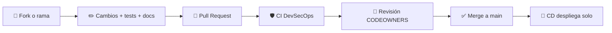

# Guía de contribución

¡Gracias por querer mejorar este proyecto! Esta guía explica **cómo proponer cambios** siguiendo el mismo flujo que enseña el curso.

> 📖 Antes de empezar, lee la [wiki](https://github.com/yembertQC/Reto_Platform-Enginner_ED-Team/wiki), sobre todo [Qué NO hacer](https://github.com/yembertQC/Reto_Platform-Enginner_ED-Team/wiki/13-Que-NO-hacer).

## 🔀 Flujo de trabajo



1. Crea una rama desde `main`: `feat/endpoint-version`, `fix/smoke-test`, `docs/laboratorio`.
2. Haz tus cambios **pequeños y enfocados** (un tema por PR).
3. Abre un **Pull Request** contra `main` y rellena la plantilla.
4. Espera a que pasen los checks de CI y a la revisión del dueño del código (ver [`CODEOWNERS`](CODEOWNERS)).
5. Nunca hagas push directo a `main`: está protegida.

## 📝 Mensajes de commit

Usamos [Conventional Commits](https://www.conventionalcommits.org/es/v1.0.0/):

| Prefijo | Para |
|---------|------|
| `feat:` | Funcionalidad nueva |
| `fix:` | Corrección de un error |
| `docs:` | Solo documentación (`doc/`) |
| `ci:` | Workflows de `.github/workflows/` |
| `refactor:` | Cambio interno sin cambiar el comportamiento |
| `test:` | Tests |
| `deps:` | Dependencias |

Ejemplo: `feat(go): añade endpoint /version`

> 🔏 Recomendado: **firma tus commits** (GPG, SSH o S/MIME). Ver [Firmar commits](https://docs.github.com/es/authentication/managing-commit-signature-verification/signing-commits).

## ✅ Antes de abrir el PR

```bash
# Go: tests (lo mismo que ejecuta CI)
cd src-go && go test -v -race ./...

# Python: arranca la app (con uv, sin tocar el Python global)
cd src && uv run --with-requirements requirements.txt python app.py

# Workflows y scripts
uvx --from actionlint-py actionlint .github/workflows/*.yml
uvx --from shellcheck-py shellcheck scripts/*.sh

# Documentación: enlaces de doc/
bash scripts/build-wiki.sh doc build/wiki https://github.com/yembertQC/Reto_Platform-Enginner_ED-Team/blob/main
```

## 📚 Reglas por tipo de cambio

| Si cambias... | Recuerda |
|---------------|----------|
| `src/` o `src-go/` | Mantener `/` y `/health` (los comprueban los tests y el smoke test) |
| `.github/workflows/` | Fijar las actions **por SHA** con comentario `# vX.Y.Z` y declarar `permissions` mínimos **por job** |
| `scripts/` | Que sigan siendo idempotentes y pasen `shellcheck` |
| Infraestructura o despliegue | Actualizar la página correspondiente de `doc/` en el **mismo PR** |
| `doc/` | Enlaces a archivos `.md` (no a la wiki); páginas nuevas en `_Sidebar.md` y `Home.md` |

## 🚫 No se aceptan

- Secretos, claves o datos personales en el código.
- Desactivar escáneres de seguridad o tests para que el pipeline "salga en verde".
- "Arreglar" las vulnerabilidades intencionales de `src-go/main.go` (son material del curso; ver [`SECURITY.md`](SECURITY.md)).

## 📄 Licencia de tus contribuciones

Al contribuir aceptas que tu aporte (código o documentación) se publique bajo la licencia [MIT](../LICENSE) del proyecto.

## 🤝 Convivencia

Este proyecto sigue un [Código de Conducta](CODE_OF_CONDUCT.md). Al participar, te comprometes a respetarlo.
