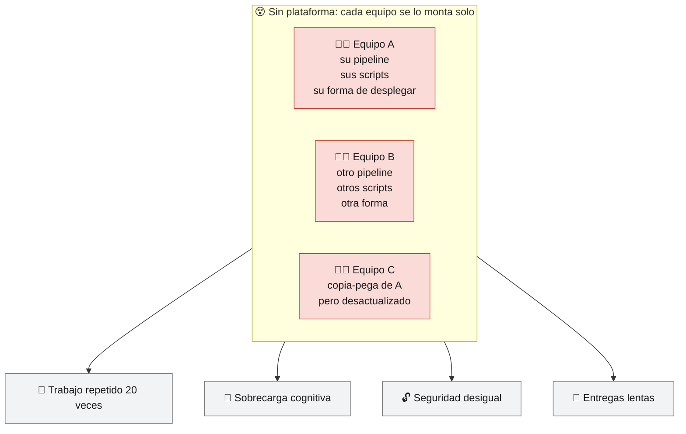
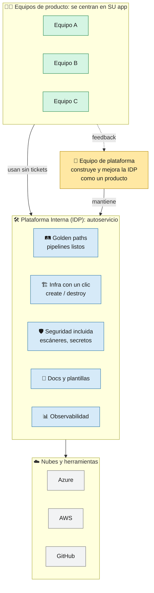
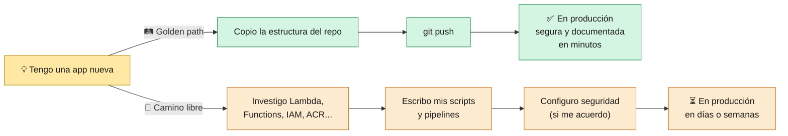
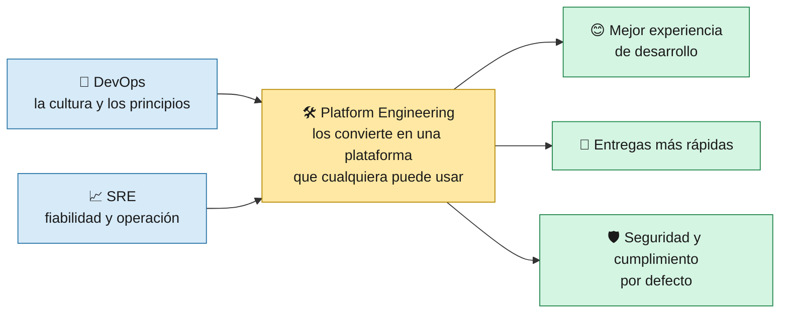
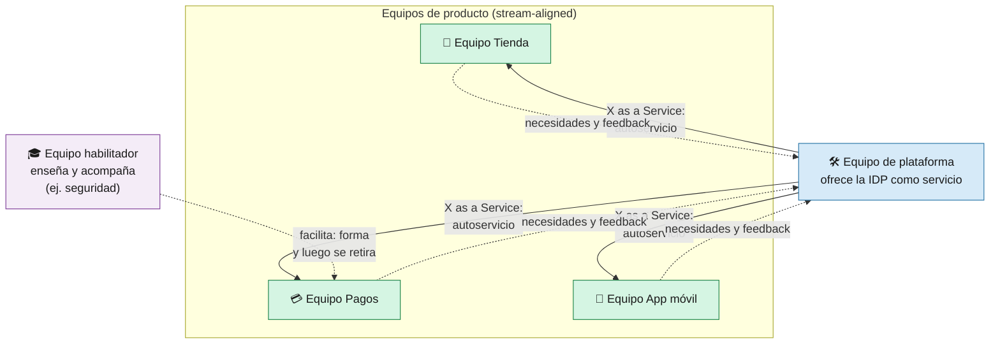

# 0 · ¿Qué es Ingeniería de Plataforma?

> 🎯 **Objetivo:** entender qué es la Ingeniería de Plataforma, qué problema resuelve y por qué este proyecto es, en pequeño, una plataforma.

---

## 🤔 El problema

Imagina una empresa con 20 equipos de desarrollo. Cada equipo, para poner su app en producción, tiene que aprender a la vez:

Docker · Kubernetes o serverless · Azure **y** AWS · redes · certificados · CI/CD · escáneres de seguridad · secretos · logs · costes...

A esto se le llama **carga cognitiva**: todo lo que un desarrollador tiene que tener en la cabeza que **no es** su producto.

---

## 💡 La solución: una plataforma interna

La **Ingeniería de Plataforma** (*Platform Engineering*) es la disciplina de **diseñar, construir y mantener una Plataforma Interna de Desarrollo** (*IDP, Internal Developer Platform*) que los equipos usan en **autoservicio** para construir, desplegar y operar sus aplicaciones.

> 🧠 **En una frase:** el equipo de plataforma convierte lo difícil y repetido en un **camino fácil, seguro y reutilizable**, y lo trata como un **producto** cuyos clientes son los desarrolladores.

---

## 🧱 Conceptos clave

| Concepto | Qué significa | Ejemplo en este repo |
|----------|---------------|----------------------|
| **Plataforma como producto** | La plataforma tiene usuarios (los devs), se diseña escuchándolos, tiene documentación y se mejora por versiones | Esta wiki, el laboratorio, el job summary con la URL |
| **Autoservicio** | El dev consigue lo que necesita **sin abrir un ticket** ni esperar a otra persona | `infraestructure.yml` → *Run workflow* → infra creada |
| **Golden path** (camino dorado) | La forma recomendada, ya resuelta y segura, de hacer algo. Es **opcional pero tan cómoda** que todos la eligen | Push a `src-go/` → tests, escaneo, build, deploy y smoke test sin hacer nada más |
| **Abstracción** | Ocultar detalles que el dev no necesita, sin impedir verlos | `CLOUD_PROVIDER=azure` o `aws`: el dev no necesita saber los comandos de cada nube |
| **Guardrails** (barandillas) | Controles automáticos que evitan errores graves sin frenar | CodeQL, Grype, environment `production` con aprobación |
| **Reutilización** | Resolver una vez y usarlo en todas partes | `scripts/deploy-lambda.sh` lo usan 3 pipelines |
| **Thinnest Viable Platform** | Empezar con la plataforma **más pequeña que aporte valor** y crecer según la demanda | Este repo: unos pocos workflows y scripts, no un portal gigante |

### 🛤️ Golden path vs camino libre

> El camino libre **no se prohíbe** (a veces hace falta), pero el golden path es tan cómodo que es la opción natural.

---

## 🆚 DevOps, SRE y Platform Engineering

No compiten: se complementan.

| | DevOps | SRE | Platform Engineering |
|-|--------|-----|----------------------|
| **Qué es** | Una **cultura**: desarrollo y operaciones trabajan juntos y automatizan | Una **práctica** de fiabilidad con ingeniería de software | Una **disciplina** que construye la plataforma interna |
| **Pregunta que responde** | ¿Cómo colaboramos y entregamos rápido? | ¿Cómo mantenemos el sistema fiable? | ¿Cómo hacemos que entregar rápido y seguro sea **fácil para todos**? |
| **Herramientas típicas** | CI/CD, IaC, automatización | SLOs, presupuestos de error, guardias, postmortems | Golden paths, portales (p. ej. Backstage), plantillas, autoservicio |
| **En este repo** | Pipelines CI/CD, infra como código | Smoke tests, health checks | Scripts reutilizables, abstracción multi-cloud, wiki, laboratorio |

---

## 👥 Cómo se organizan los equipos

Según el modelo **Team Topologies**, el equipo de plataforma da servicio a los equipos de producto (*stream-aligned*) para que estos puedan ir rápido sin depender de nadie:

---

## 🧩 Las capas de una plataforma interna

| Capa | Qué ofrece | En este repo | Lo que faltaría en una empresa real |
|------|-----------|--------------|-------------------------------------|
| 🖥️ Interfaz para devs | Dónde se piden las cosas | GitHub Actions (*Run workflow*) + wiki | Un portal (Backstage, Port...) con catálogo de servicios |
| 🛤️ Integración y entrega | Pipelines estándar | `ci*.yml`, `cd*.yml` | Workflows reutilizables (`workflow_call`) versionados para todos los repos |
| 🏗️ Infraestructura | Recursos bajo demanda | `infraestructure.yml` con CLI | IaC declarativa con estado (Terraform, Bicep, Pulumi) |
| 🛡️ Seguridad | Guardrails | CodeQL, Grype, SCA, aprobaciones | OIDC en vez de claves fijas, políticas (OPA, Azure Policy), firma de imágenes |
| 📊 Observabilidad | Logs, métricas, trazas | Logs básicos | Dashboards, alertas y SLOs estándar por servicio |
| 💰 Costes | Visibilidad del gasto | `destroy` manual | Etiquetas, presupuestos y alertas de coste |
| 📖 Conocimiento | Documentación | Esta wiki (docs as code) | Docs generadas por servicio en el portal |

---

## 📏 ¿Cómo sé si una plataforma funciona?

Se mide, como cualquier producto. Las métricas más usadas son las **DORA**:

| Métrica DORA | Pregunta | Cómo ayuda este repo |
|--------------|----------|----------------------|
| **Frecuencia de despliegue** | ¿Cada cuánto llega algo a producción? | Cada push a `main` despliega solo |
| **Lead time de cambios** | ¿Cuánto tarda un commit en estar en producción? | Minutos: build → release → deploy automáticos |
| **Tasa de fallos de cambios** | ¿Qué % de despliegues rompe algo? | Tests + smoke test frenan lo roto |
| **Tiempo de recuperación** | ¿Cuánto tardamos en arreglar un fallo? | Releases con tag por commit: se sabe qué se desplegó y se puede volver a una versión anterior |

Y además, la **experiencia del desarrollador**: ¿la gente **elige** usar la plataforma? ¿cuánto tarda alguien nuevo en hacer su primer despliegue? (en este repo: el [laboratorio](08-Laboratorio-Paso-a-Paso.md)).

---

## ✅ Resumen

- **Ingeniería de Plataforma** = construir una **plataforma interna de autoservicio**, tratada como **producto**, que reduce la carga cognitiva de los equipos.
- Sus herramientas son los **golden paths**, la **abstracción**, los **guardrails** y la **documentación**.
- Este repo es una **plataforma mínima**: pipelines estándar, scripts reutilizables, multi-cloud con una variable, seguridad por defecto y docs como código.
- Igual de importante es saber **qué no hacer**: ver [13 · ⛔ Qué NO hacer](13-Que-NO-hacer.md).

➡️ Siguiente: [1 · Introducción a Serverless](01-Introduccion-Serverless.md)
