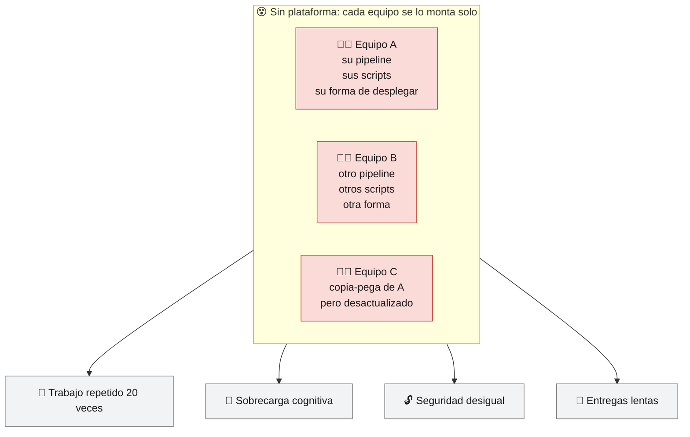
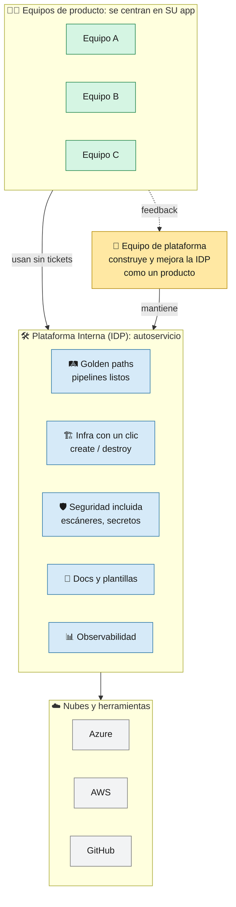
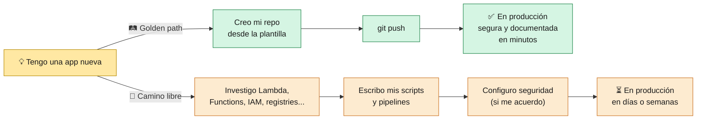
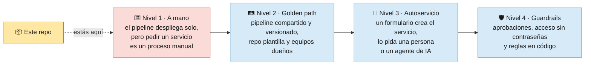
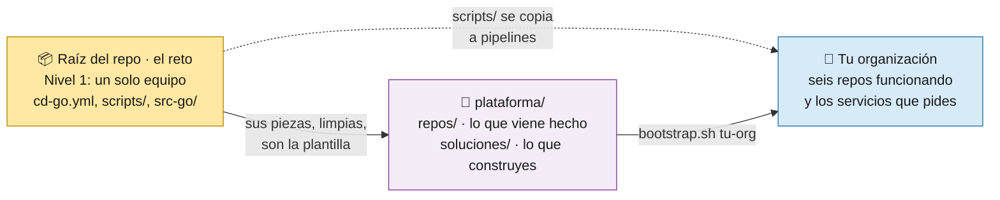
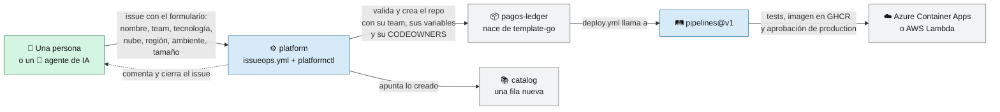
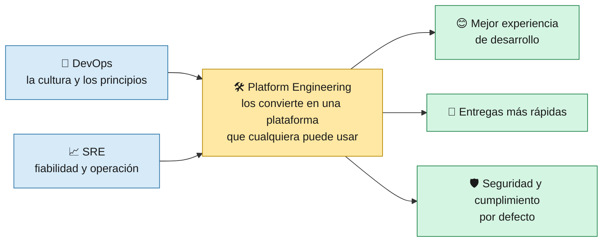
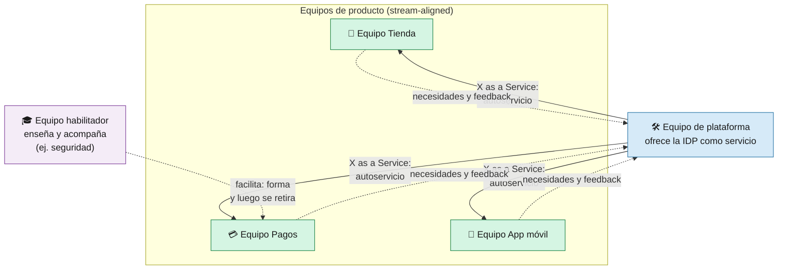

# 0 · ¿Qué es Ingeniería de Plataforma?

> 🎯 **Objetivo:** entender qué es la Ingeniería de Plataforma, qué problema resuelve y qué lugar ocupa este proyecto: el punto de partida desde el que se construye una.

---

## 🤔 El problema

Imagina una empresa con 20 equipos de desarrollo. Cada equipo, para poner su app en producción, tiene que aprender a la vez:

Docker · Kubernetes o serverless · Azure **y** AWS · redes · certificados · CI/CD · escáneres de seguridad · secretos · logs · costes...

A esto se le llama **carga cognitiva**: todo lo que un desarrollador tiene que tener en la cabeza que **no es** su producto.

---

## 💡 La solución: una plataforma interna

La **Ingeniería de Plataforma** (*Platform Engineering*) es la disciplina de **diseñar, construir y mantener una Plataforma Interna de Desarrollo** (*IDP, Internal Developer Platform*) que los equipos usan en **autoservicio** para construir, desplegar y operar sus aplicaciones.

> 🧠 **En una frase:** el equipo de plataforma convierte lo difícil y repetido en un **camino fácil, seguro y reutilizable**, y lo trata como un **producto** cuyos clientes son los desarrolladores.

---

## 🧱 Conceptos clave

| Concepto | Qué significa | Ejemplo en este repo |
|----------|---------------|----------------------|
| **Plataforma como producto** | La plataforma tiene usuarios (los devs), se diseña escuchándolos, tiene documentación y se mejora por versiones | Esta wiki, el laboratorio, el job summary con la URL |
| **Autoservicio** | El dev consigue lo que necesita **sin abrir un ticket** ni esperar a otra persona | A medias: `infraestructure.yml` → *Run workflow* crea la infra, pero dar de alta un servicio nuevo sigue siendo el [laboratorio](08-Laboratorio-Paso-a-Paso.md) manual |
| **Golden path** (camino dorado) | La forma recomendada, ya resuelta y segura, de hacer algo. Es **opcional pero tan cómoda** que todos la eligen | Push a `src-go/` → tests, escaneo, build, deploy y smoke test sin hacer nada más. Es el golden path de **un** equipo: otro tendría que copiarlo |
| **Abstracción** | Ocultar detalles que el dev no necesita, sin impedir verlos | `CLOUD_PROVIDER=azure` o `aws`: el dev no necesita saber los comandos de cada nube |
| **Guardrails** (barandillas) | Controles automáticos que evitan errores graves sin frenar | CodeQL, Grype, environment `production` con aprobación |
| **Reutilización** | Resolver una vez y usarlo en todas partes | `scripts/deploy-lambda.sh` lo usan 3 pipelines |
| **Thinnest Viable Platform** | Empezar con la plataforma **más pequeña que aporte valor** y crecer según la demanda | El siguiente paso desde este repo es un pipeline compartido y un formulario, no un portal gigante |

### 🛤️ Golden path vs camino libre

> El camino libre **no se prohíbe** (a veces hace falta), pero el golden path es tan cómodo que es la opción natural.

---

## 🧭 ¿Dónde está este repo? El punto de partida

Este repo **no es todavía una plataforma**: es el golden path de **un solo equipo**. El pipeline despliega solo, pero llegar hasta el pipeline es manual: hay que copiar el repo, crear los secretos y las variables, configurar el environment y lanzar la infraestructura (el [laboratorio](08-Laboratorio-Paso-a-Paso.md)). Y todo tiene un único dueño.

Una plataforma madura por niveles. Este repo es el primero, y el curso construye los siguientes encima, en repos nuevos de tu organización:

| Nivel | Qué cambia | De qué pieza de este repo sale |
|-------|-----------|--------------------------------|
| 2 · Golden path | El pipeline deja de copiarse: vive en un repo y los demás lo llaman por versión | `cd-go.yml` y `scripts/` |
| 2 · Golden path | Un servicio nuevo nace de una plantilla, ya conectado al pipeline | `src-go/` (sin los endpoints vulnerables) |
| 2 · Golden path | Cada automatización tiene un equipo responsable | `.github/CODEOWNERS`, hoy con un solo dueño |
| 3 · Autoservicio | El alta de un servicio se pide con un formulario y la ejecuta un programa | El laboratorio manual de las páginas 7 y 8 |
| 4 · Guardrails | La nube se alcanza sin secretos guardados y las reglas se aplican a todos | Los tres secretos estáticos y el environment `production` |

### 🗺️ Del repo del reto a tu organización

El repo tiene dos partes. La raíz es el reto: el "antes", un solo equipo, y **no se convierte en la plataforma**. La carpeta [`plataforma/`](../plataforma/README.md) es la **plantilla del curso**: seis repos listos para subir a una organización de GitHub con un comando. No se despliega desde aquí.

`bash plataforma/bootstrap.sh <tu-org>` crea estos seis repos:

| Repo | Para qué sirve | De qué pieza del reto sale | Dónde se ve |
|------|----------------|----------------------------|-------------|
| `.github` | La portada de la organización: qué es cada repo y el enlace al formulario | — | M1 · Clase 3 |
| `pipelines` | El camino a producción: `build.yml` reutilizable (`workflow_call`) con tres datos (servicio, lenguaje y ambiente), publicado como `@v1`. Despliega en Azure o AWS según la variable de la organización | `cd-go.yml`, `cd.yml` y `scripts/` | M1 · Clase 4 (lo generas con Copilot); la `v2`, en M2 · Clase 5 |
| `template-go` | De donde nace un servicio en Go: la app y un `deploy.yml` de ocho líneas que llama a `pipelines@v1` | `src-go/`, sin `/search`, `/exec` ni las credenciales | M1 · Clase 4 |
| `template-python` | Lo mismo en Python (Flask, puerto 8080) | `src/app.py`, sin Azure Functions | M1 · Clase 4 |
| `platform` | El **orquestador**: recibe los pedidos por issue (IssueOps) y `platformctl` valida y crea el repo. La configuración dice qué se permite y la regla en código (OPA) viene escrita y apagada | El laboratorio manual de las páginas 7 y 8, convertido en programa | M1 · Clase 6; M2 · Clases 1 y 3 |
| `catalog` | La lista de lo que la plataforma creó: qué, de quién, dónde, en qué ambiente y si lo pidió una persona o un agente de IA | — | M1 · Clase 6; métricas en M2 · Clase 4 |

**Viene hecho** lo pesado: `platformctl`, la regla OPA, el catálogo y las plantillas. **Lo construyes tú**, clase a clase: el `build.yml` con su tag `v1` (Clase 4), los teams y los `CODEOWNERS` (Clase 5), el formulario y las instrucciones para agentes (Clase 6), y el ambiente de producción protegido (M2 · Clase 3). Las soluciones están en `plataforma/soluciones/`; `bootstrap.sh <org> --completo` las pone todas de una vez.

Así viaja una solicitud dentro de tu organización:

Un agente de IA pide igual que una persona: llena el mismo formulario siguiendo `platform/AGENTS.md` y marca el issue con `platform/agent`. La plataforma le aplica las mismas reglas; la etiqueta solo sirve para medir.

> 🧠 **Por qué la plataforma no es la raíz del repo.** Si el reto se convirtiera en la plataforma, cada organización nueva heredaría también lo que tiene a propósito para la demo: los endpoints vulnerables de `src-go/main.go`, el `CODEOWNERS` de una sola persona y el despliegue de un único equipo. Por eso las piezas se limpian y viven aparte, en `plataforma/`.

> 🪟 **¿Y el portal?** El Módulo 1 termina en "autoservicio sin portal": un formulario de issue ya es autoservicio. Como extra, `plataforma/extras/portal/` trae un portal web que un equipo de producto le propone a la plataforma con un pull request (InnerSource). Es una cara nueva sobre el mismo IssueOps, sin backend.

---

## 🆚 DevOps, SRE y Platform Engineering

No compiten: se complementan.

| | DevOps | SRE | Platform Engineering |
|-|--------|-----|----------------------|
| **Qué es** | Una **cultura**: desarrollo y operaciones trabajan juntos y automatizan | Una **práctica** de fiabilidad con ingeniería de software | Una **disciplina** que construye la plataforma interna |
| **Pregunta que responde** | ¿Cómo colaboramos y entregamos rápido? | ¿Cómo mantenemos el sistema fiable? | ¿Cómo hacemos que entregar rápido y seguro sea **fácil para todos**? |
| **Herramientas típicas** | CI/CD, IaC, automatización | SLOs, presupuestos de error, guardias, postmortems | Golden paths, portales (p. ej. Backstage), plantillas, autoservicio |
| **En este repo** | Pipelines CI/CD, infra como código | Smoke tests, health checks | Scripts reutilizables, abstracción multi-cloud, wiki, laboratorio |

---

## 👥 Cómo se organizan los equipos

Según el modelo **Team Topologies**, el equipo de plataforma da servicio a los equipos de producto (*stream-aligned*) para que estos puedan ir rápido sin depender de nadie:

---

## 🧩 Las capas de una plataforma interna

| Capa | Qué ofrece | En este repo | Lo que faltaría en una empresa real |
|------|-----------|--------------|-------------------------------------|
| 🖥️ Interfaz para devs | Dónde se piden las cosas | GitHub Actions (*Run workflow*) + wiki | Un formulario de solicitud (IssueOps) o un portal (Backstage, Port...) con catálogo de servicios |
| 🛤️ Integración y entrega | Pipelines estándar | `ci*.yml`, `cd*.yml` | Workflows reutilizables (`workflow_call`) versionados para todos los repos |
| 🏗️ Infraestructura | Recursos bajo demanda | `infraestructure.yml` con CLI | IaC declarativa con estado (Terraform, Bicep, Pulumi) |
| 🛡️ Seguridad | Guardrails | CodeQL, Grype, SCA, aprobaciones | OIDC en vez de claves fijas, políticas (OPA, Azure Policy), firma de imágenes |
| 📊 Observabilidad | Logs, métricas, trazas | Logs básicos | Dashboards, alertas y SLOs estándar por servicio |
| 💰 Costes | Visibilidad del gasto | `destroy` manual | Etiquetas, presupuestos y alertas de coste |
| 📖 Conocimiento | Documentación | Esta wiki (docs as code) | Docs generadas por servicio en el portal |

---

## 📏 ¿Cómo sé si una plataforma funciona?

Se mide, como cualquier producto. Las métricas más usadas son las **DORA**:

| Métrica DORA | Pregunta | Cómo ayuda este repo |
|--------------|----------|----------------------|
| **Frecuencia de despliegue** | ¿Cada cuánto llega algo a producción? | Cada push a `main` despliega solo |
| **Lead time de cambios** | ¿Cuánto tarda un commit en estar en producción? | Minutos: build → release → deploy automáticos |
| **Tasa de fallos de cambios** | ¿Qué % de despliegues rompe algo? | Tests + smoke test frenan lo roto |
| **Tiempo de recuperación** | ¿Cuánto tardamos en arreglar un fallo? | Releases con tag por commit: se sabe qué se desplegó y se puede volver a una versión anterior |

Y además, la **experiencia del desarrollador**: ¿la gente **elige** usar la plataforma? ¿cuánto tarda alguien nuevo en hacer su primer despliegue? (en este repo: el [laboratorio](08-Laboratorio-Paso-a-Paso.md)).

---

## ✅ Resumen

- **Ingeniería de Plataforma** = construir una **plataforma interna de autoservicio**, tratada como **producto**, que reduce la carga cognitiva de los equipos.
- Sus herramientas son los **golden paths**, la **abstracción**, los **guardrails** y la **documentación**.
- Este repo es el **punto de partida**: el golden path de un solo equipo (pipelines estándar, scripts reutilizables, multi-cloud con una variable, seguridad por defecto y docs como código).
- Lo que le falta para ser plataforma (pipeline compartido, autoservicio, dueños por equipo y guardrails para todos) se construye encima, a partir de sus piezas.
- Igual de importante es saber **qué no hacer**: ver [13 · ⛔ Qué NO hacer](13-Que-NO-hacer.md).

➡️ Siguiente: [1 · Introducción a Serverless](01-Introduccion-Serverless.md)
