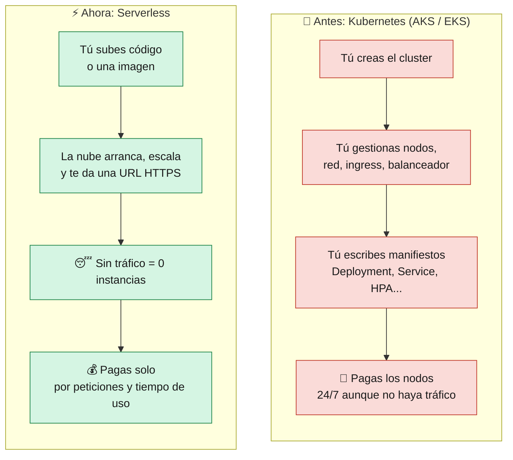
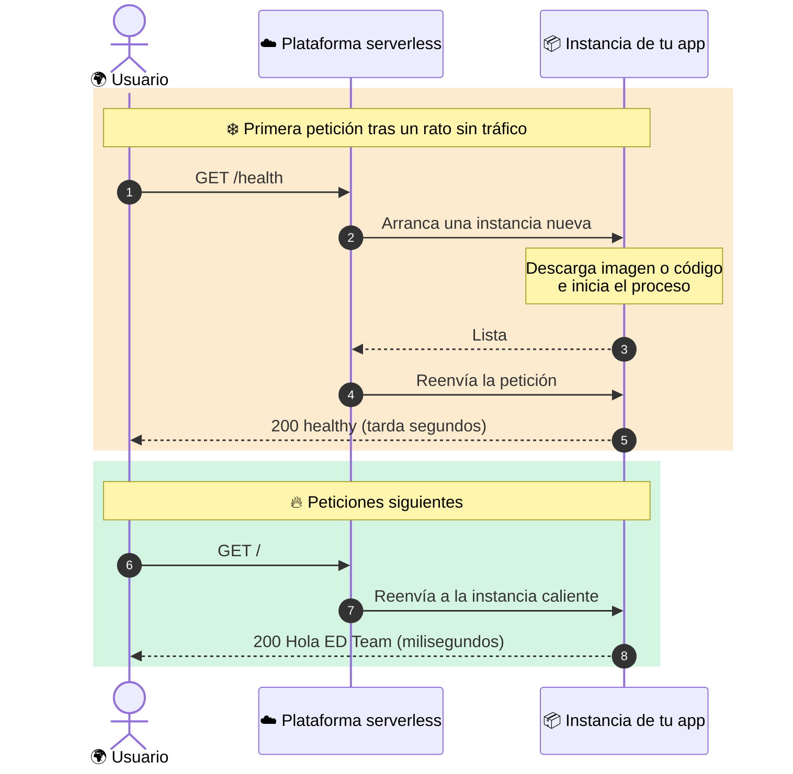
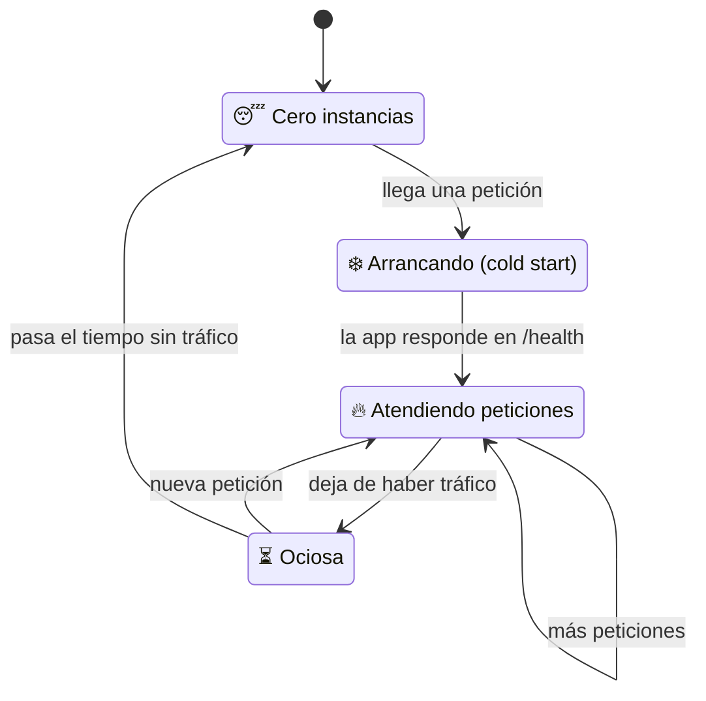
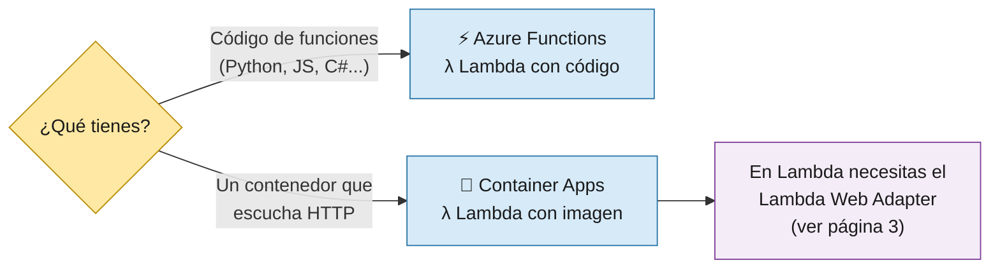

# 1 · Introducción a Serverless

⬅️ Anterior: [0 · ¿Qué es Ingeniería de Plataforma?](00-Ingenieria-de-Plataforma.md)

> 🎯 **Objetivo:** entender qué es serverless, en qué se diferencia de Kubernetes y qué servicios usamos en este proyecto.

---

## ¿Qué es serverless?

En el modelo tradicional tú alquilas **máquinas** (o un cluster de Kubernetes) y pagas por ellas **aunque nadie use tu app**. En serverless entregas **tu código o tu contenedor** y la nube:

- 🚀 lo **arranca** cuando llega una petición,
- 📈 lo **escala** si llegan muchas,
- 😴 lo **apaga** (escala a cero) cuando no hay tráfico,
- 💰 te **cobra por uso**, no por tiempo encendido.

---

## Kubernetes vs Serverless

| Tema | Kubernetes (lo que había antes) | Serverless (lo que hay ahora) |
|------|----------------------------------|-------------------------------|
| Qué administras | Cluster, nodos, ingress, manifiestos | Solo tu app y su configuración |
| Escalado | HPA: mínimo 2 pods siempre encendidos | Automático, **desde 0** |
| URL pública | LoadBalancer + Traefik + Ingress | Incluida y con HTTPS |
| Tiempo de crear infra | 10-20 minutos (cluster) | 1-3 minutos |
| Coste en reposo | Nodos encendidos 24/7 | Prácticamente 0 |
| Desventaja principal | Complejidad operativa | **Cold start** y menos control |

> 🧠 **Ninguno es "mejor" siempre.** Kubernetes brilla con muchas apps, tráfico constante o necesidades especiales de red. Serverless brilla con tráfico variable, equipos pequeños y apps HTTP sencillas como la nuestra.

---

## ❄️ El cold start (arranque en frío)

Si tu app escaló a cero, la **primera** petición tiene que esperar a que la nube arranque una instancia. Eso es el *cold start*. Las siguientes peticiones ya encuentran la instancia "caliente".

Por eso el `smoke-test.sh` del pipeline **reintenta** varias veces antes de dar un despliegue por fallido.

### Ciclo de vida de una instancia

---

## 🧰 Los servicios que usamos

| Servicio | Nube | Qué despliegas | Lo usamos para | Escala a cero |
|----------|------|----------------|----------------|---------------|
| ⚡ **Azure Functions** (Flex Consumption) | Azure | **Código** (un zip con Python) | App Python | ✅ |
| 🐳 **Azure Container Apps** | Azure | **Imagen de contenedor** | App Go | ✅ (`minReplicas 0`) |
| λ **AWS Lambda** | AWS | **Imagen de contenedor** (o código) | Apps Python y Go | ✅ |

---

## ✅ Resumen

- Serverless = **no administras servidores**, pagas por uso y escalas a cero.
- El precio a pagar es el **cold start**.
- Usamos **3 servicios**: Azure Functions, Azure Container Apps y AWS Lambda.

➡️ Siguiente: [2 · Arquitectura](02-Arquitectura.md)
