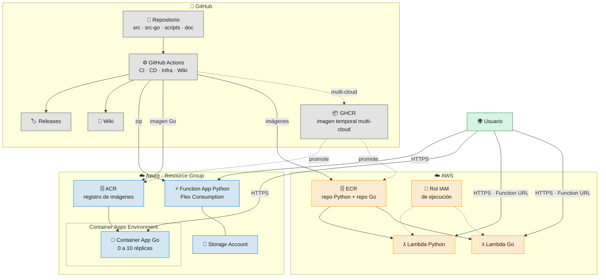
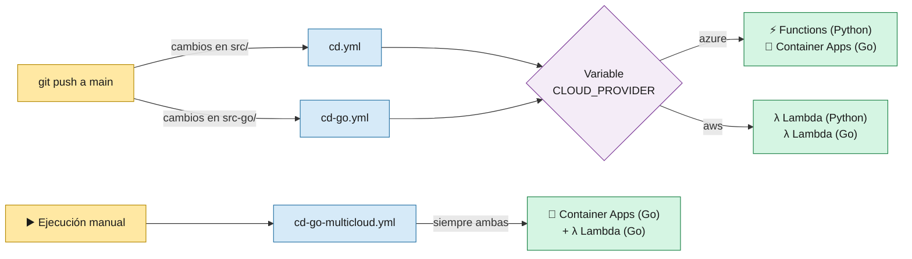
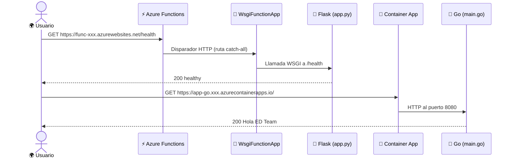
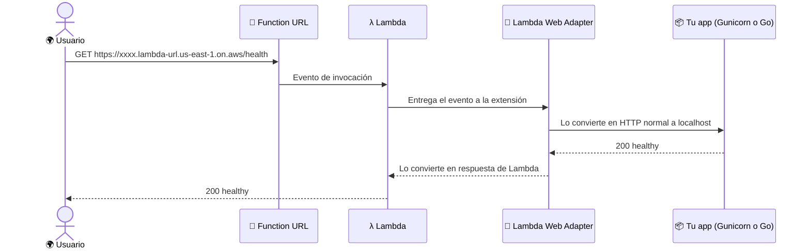
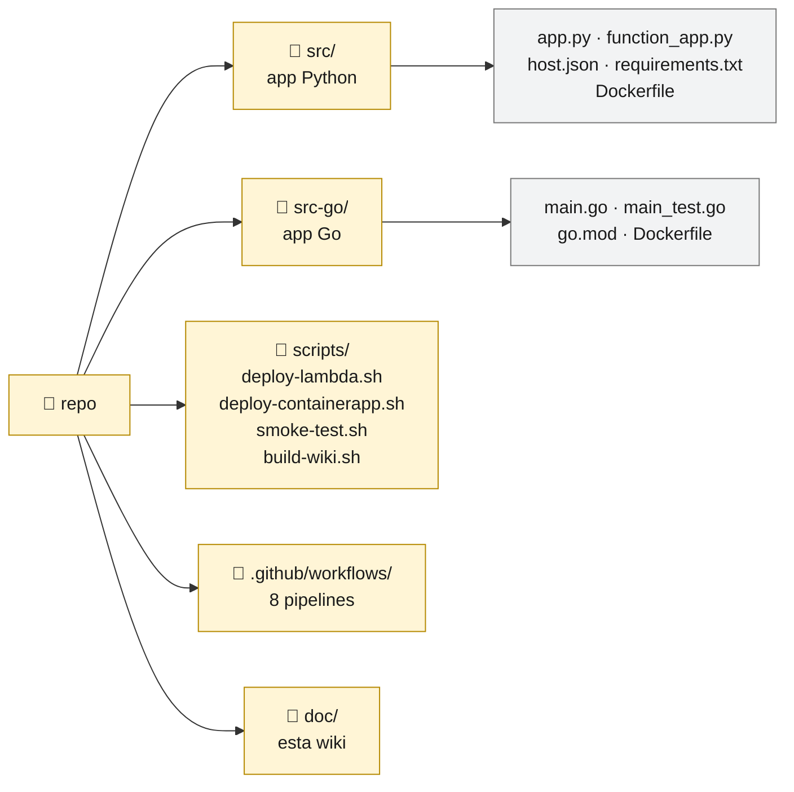

# 2 · Arquitectura

> 🎯 **Objetivo:** ver todas las piezas del sistema y cómo se conectan, de GitHub a la nube y de la nube al usuario.

---

## 🧩 Vista general

| App | Azure | AWS |
|-----|-------|-----|
| 🐍 Python | ⚡ Azure Functions: código en zip, Flask montado con `WsgiFunctionApp` | λ Lambda: imagen de contenedor + Lambda Web Adapter |
| 🐹 Go | 🐳 Container Apps: imagen desde ACR | λ Lambda: la **misma** imagen + Lambda Web Adapter |

---

## 🔀 ¿A qué nube despliega cada pipeline?

- `cd.yml` y `cd-go.yml` despliegan a **una sola nube**, la que diga la variable `CLOUD_PROVIDER`.
- `cd-go-multicloud.yml` despliega la app Go en **las dos a la vez**.

---

## 🌐 Cómo viaja una petición

### Azure

### AWS

> 🔎 El **Lambda Web Adapter** es la pieza clave en AWS: permite usar una app web normal dentro de Lambda sin reescribirla. Se explica en [3 · Aplicaciones](03-Aplicaciones.md).

---

## 🏷️ Nombres de los recursos

Todos los nombres salen de **variables de GitHub** (ver [7 · Configuración de GitHub](07-Configuracion-GitHub.md)):

| Recurso | Nombre | Ejemplo |
|---------|--------|---------|
| ACR | `REGISTRY_NAME` | `acredteamdevsecops` |
| Container Apps Environment | `CONTAINERAPP_ENV_NAME` | `cae-edteam` |
| Container App Go | `<CONTAINER_NAME>-go` | `ed-team-app-go` |
| Function App Python | `FUNCTION_APP_NAME` | `func-edteam-app` |
| Storage Account | `STORAGE_ACCOUNT_NAME` | `stedteamfunc` |
| Repo ECR / Lambda Python | `ECR_REPOSITORY_NAME` | `ed-team-app` |
| Repo ECR / Lambda Go | `<ECR_REPOSITORY_NAME>-go` | `ed-team-app-go` |
| Rol IAM de Lambda | `<ECR_REPOSITORY_NAME>-lambda-role` | `ed-team-app-lambda-role` |

### Imágenes y releases

| Artefacto | Formato |
|-----------|---------|
| Imagen Go en Azure | `<REGISTRY_NAME>.azurecr.io/<CONTAINER_NAME>-go:<sha_corto>` |
| Imagen Python en AWS | `<cuenta>.dkr.ecr.<región>.amazonaws.com/<ECR_REPOSITORY_NAME>:<sha_corto>` |
| Imagen Go en AWS | `<cuenta>.dkr.ecr.<región>.amazonaws.com/<ECR_REPOSITORY_NAME>-go:<sha_corto>` |
| Imagen temporal multi-cloud | `ghcr.io/<owner>/ed-team-app-go-multicloud:mc-<run_id>-<sha_corto>` |
| Release Python | `v<AAAAMMDD>-<sha_corto>` |
| Release Go | `go-v<AAAAMMDD>-<sha_corto>` |
| Release Go multi-cloud | `go-mc-v<AAAAMMDD>-<sha_corto>` |

---

## 📂 Mapa del repositorio

➡️ Siguiente: [3 · Aplicaciones](03-Aplicaciones.md)
