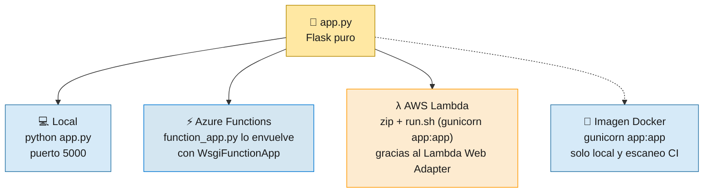
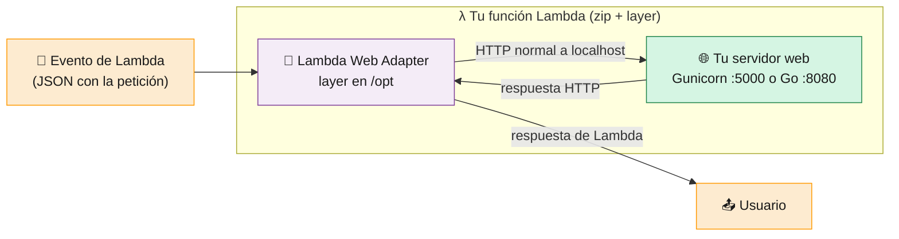
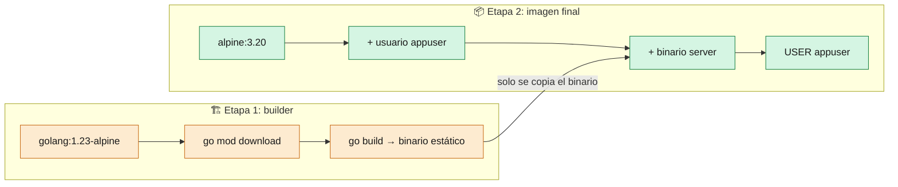

# 3 · Aplicaciones

> 🎯 **Objetivo:** entender el código de las dos apps y cómo **el mismo código** corre en local, en Azure y en AWS sin cambios.

---

## 🐍 App Python — `src/`

| Archivo | Para qué sirve |
|---------|----------------|
| [`app.py`](../src/app.py) | La app Flask. **No sabe nada de ninguna nube.** |
| [`function_app.py`](../src/function_app.py) | Puerta de entrada para **Azure Functions**: envuelve `app.py` |
| [`host.json`](../src/host.json) | Configuración de Azure Functions (quita el prefijo `/api`) |
| [`requirements.txt`](../src/requirements.txt) | `Flask`, `gunicorn`, `azure-functions` |
| [`.funcignore`](../src/.funcignore) | Archivos que **no** se suben a Azure Functions |
| [`run.sh`](../src/run.sh) | Arranque en **AWS Lambda**: lanza Gunicorn en `$PORT` (no se sube a Azure Functions) |
| [`Dockerfile`](../src/Dockerfile) | Imagen para probar en local y para el escaneo de seguridad del CI (**ningún despliegue la usa**) |

```python
# app.py — la app completa
app = Flask(__name__)

@app.route('/')
def hello():
    return jsonify({"message": "Hola ED Team"})

@app.route('/health')
def health():
    return jsonify({"status": "healthy"})
```

### Un mismo `app.py`, tres formas de ejecutarse



### ⚡ Cómo se adapta Flask a Azure Functions

Azure Functions espera **funciones**, no una app web. En vez de reescribir Flask, usamos un adaptador que ya trae la librería `azure-functions`:

```python
# function_app.py
import azure.functions as func
from app import app as flask_app

app = func.WsgiFunctionApp(
    app=flask_app.wsgi_app,
    http_auth_level=func.AuthLevel.ANONYMOUS,
)
```

- `WsgiFunctionApp` registra **una sola función HTTP** con ruta comodín `/{*route}`: cualquier URL entra y se la pasa a Flask.
- `AuthLevel.ANONYMOUS` hace que la URL sea pública (sin clave de función).
- En `host.json`, `"routePrefix": ""` evita que Azure añada `/api` delante: así la URL es `/health` y no `/api/health`.

> ⚠️ `azure-functions` **2.x** solo funciona con **Python 3.13 o superior**. Si algún día usas Python 3.12 en Azure, cambia a `azure-functions` 1.x.

---

## 🐹 App Go — `src-go/`

| Archivo | Para qué sirve |
|---------|----------------|
| [`main.go`](../src-go/main.go) | Servidor `net/http` en el puerto 8080 |
| [`main_test.go`](../src-go/main_test.go) | Tests de `/` y `/health` con `httptest` |
| [`Dockerfile`](../src-go/Dockerfile) | Imagen multi-stage para **Container Apps** (publicada en GHCR) y para probar en local |

Además de `/` y `/health`, `main.go` tiene endpoints con **vulnerabilidades a propósito** (`/search`, `/exec`) para que el escáner de seguridad las detecte. Ver [10 · Seguridad](10-Seguridad.md).

```bash
cd src-go
go run main.go                              # http://localhost:8080
go test -v -race ./...                      # todos los tests
go test -v -run TestHealthHandler ./...     # un solo test
```

---

## 🔌 El truco: AWS Lambda Web Adapter

Lambda no habla HTTP directamente: recibe **eventos**. Nuestras apps sí hablan HTTP. El [AWS Lambda Web Adapter](https://github.com/aws/aws-lambda-web-adapter) hace de **traductor**. No va dentro de ninguna imagen: [`deploy-lambda.sh`](../scripts/deploy-lambda.sh) lo añade a la función como **layer** (una capa de archivos que Lambda monta en `/opt`), la que publica AWS:

```text
arn:aws:lambda:<región>:753240598075:layer:LambdaAdapterLayerX86:30
```

> 🔢 La versión (`30`) se puede cambiar con la variable de entorno `LWA_LAYER_VERSION`. Antes de desplegar, el script comprueba que la layer existe en tu región y, si no, falla con un mensaje claro.

Cada app llega a Lambda como un **paquete zip** (sin imagen ni registry):

| | Python | Go |
|-|--------|----|
| Paquete | `lambda-python.zip`: `app.py`, `run.sh` y las dependencias (`pip --target`, wheels `manylinux2014_x86_64` para Python 3.13) | `lambda-go.zip`: el binario `bootstrap` (`CGO_ENABLED=0 GOOS=linux GOARCH=amd64`) |
| Runtime | `python3.13` | `provided.al2023` |
| Handler | `run.sh` | `bootstrap` |
| Quién arranca el servidor | `AWS_LAMBDA_EXEC_WRAPPER=/opt/bootstrap`: el adapter ejecuta [`run.sh`](../src/run.sh), que lanza Gunicorn en `$PORT` | El propio binario `bootstrap` es el servidor `net/http` |



Las variables de entorno las pone `deploy-lambda.sh` en las dos Lambdas:

| Variable | Valor | Qué hace |
|----------|-------|----------|
| `PORT` | `5000` (Python) / `8080` (Go) | Puerto en el que arranca tu app |
| `AWS_LWA_PORT` | `5000` (Python) / `8080` (Go) | Puerto donde el adapter busca tu app |
| `AWS_LWA_READINESS_CHECK_PATH` | `/health` | El adapter espera a que esta ruta responda antes de enviar tráfico |
| `ENVIRONMENT` | `production` | Entorno de la app |
| `AWS_LAMBDA_EXEC_WRAPPER` | `/opt/bootstrap` (solo Python) | Hace que el adapter arranque `run.sh` |

> 🪄 El código de las apps **no cambia**: el mismo `app.py` y el mismo `main.go` corren en local, en Docker, en Azure y en Lambda. Lo que cambia es **el empaquetado** de cada destino: zip para Lambda y Azure Functions, imagen solo para Container Apps.

---

## 🐳 Los Dockerfiles

| | Python (`src/Dockerfile`) | Go (`src-go/Dockerfile`) |
|-|---------------------------|---------------------------|
| Imagen base | `python:3.13-slim` | build en `golang:1.23-alpine` → final `alpine:3.20` |
| Usuario | `appuser` (uid 1000), **no root** | `appuser` (uid 1000), **no root** |
| Puerto | 5000 | 8080 |
| Arranque | `gunicorn --bind 0.0.0.0:5000 app:app` | `./server` |
| Dónde se usa | Local y escaneo de seguridad del CI | Azure Container Apps (vía GHCR), local y escaneo del CI |

> ℹ️ Los Dockerfiles ya **no** llevan el Lambda Web Adapter: en AWS las apps van como zip con el adapter en una layer.



> 🧠 **Multi-stage** = compilas en una imagen grande con todas las herramientas y copias **solo el binario** a una imagen pequeña. Menos tamaño, menos vulnerabilidades.

### ¿Por qué `--platform linux/amd64 --provenance=false --sbom=false`?

Al construir la imagen de Go, Docker moderno crea por defecto un **índice** (varios manifiestos) con metadatos extra (*attestations* de procedencia y SBOM). Con estas opciones se publica en GHCR **un solo manifiesto `linux/amd64`**, la arquitectura en la que corre Container Apps: una imagen simple, sin entradas extra en el paquete y con un digest que apunta directamente a lo que se ejecuta. Lambda ya no usa imágenes, así que no le afecta.

---

## 💻 Probar en tu máquina

```bash
# Python directo (con uv, sin tocar el Python global)
cd src && uv run --with-requirements requirements.txt python app.py    # http://localhost:5000

# Python como Azure Function (requiere Azure Functions Core Tools)
cd src && func start

# Go
cd src-go && go run main.go                                            # http://localhost:8080

# Con Docker (la imagen de Go es la que va a Container Apps; la de Python es solo local)
docker build -t ed-team-app src/       && docker run -p 5000:5000 ed-team-app
docker build -t ed-team-app-go src-go/ && docker run -p 8080:8080 ed-team-app-go

curl http://localhost:5000/health
```

➡️ Siguiente: [4 · Pipeline CI DevSecOps](04-Pipeline-CI-DevSecOps.md)
