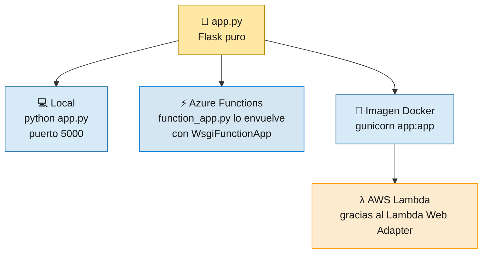
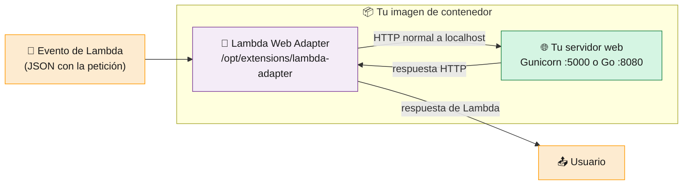
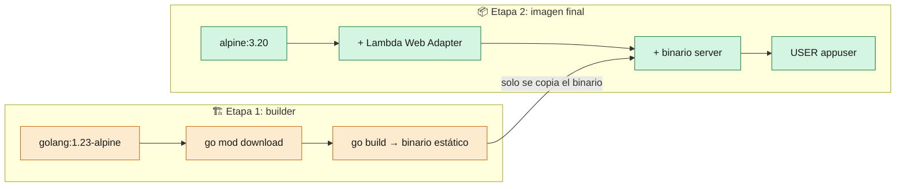

# 3 · Aplicaciones

> 🎯 **Objetivo:** entender el código de las dos apps y cómo **el mismo código** corre en local, en Azure y en AWS sin cambios.

---

## 🐍 App Python — `src/`

| Archivo | Para qué sirve |
|---------|----------------|
| [`app.py`](../src/app.py) | La app Flask. **No sabe nada de ninguna nube.** |
| [`function_app.py`](../src/function_app.py) | Puerta de entrada para **Azure Functions**: envuelve `app.py` |
| [`host.json`](../src/host.json) | Configuración de Azure Functions (quita el prefijo `/api`) |
| [`requirements.txt`](../src/requirements.txt) | `Flask`, `gunicorn`, `azure-functions` |
| [`.funcignore`](../src/.funcignore) | Archivos que **no** se suben a Azure Functions |
| [`Dockerfile`](../src/Dockerfile) | Imagen para **AWS Lambda** y para probar en local |

```python
# app.py — la app completa
app = Flask(__name__)

@app.route('/')
def hello():
    return jsonify({"message": "Hola ED Team"})

@app.route('/health')
def health():
    return jsonify({"status": "healthy"})
```

### Un mismo `app.py`, tres formas de ejecutarse



### ⚡ Cómo se adapta Flask a Azure Functions

Azure Functions espera **funciones**, no una app web. En vez de reescribir Flask, usamos un adaptador que ya trae la librería `azure-functions`:

```python
# function_app.py
import azure.functions as func
from app import app as flask_app

app = func.WsgiFunctionApp(
    app=flask_app.wsgi_app,
    http_auth_level=func.AuthLevel.ANONYMOUS,
)
```

- `WsgiFunctionApp` registra **una sola función HTTP** con ruta comodín `/{*route}`: cualquier URL entra y se la pasa a Flask.
- `AuthLevel.ANONYMOUS` hace que la URL sea pública (sin clave de función).
- En `host.json`, `"routePrefix": ""` evita que Azure añada `/api` delante: así la URL es `/health` y no `/api/health`.

> ⚠️ `azure-functions` **2.x** solo funciona con **Python 3.13 o superior**. Si algún día usas Python 3.12 en Azure, cambia a `azure-functions` 1.x.

---

## 🐹 App Go — `src-go/`

| Archivo | Para qué sirve |
|---------|----------------|
| [`main.go`](../src-go/main.go) | Servidor `net/http` en el puerto 8080 |
| [`main_test.go`](../src-go/main_test.go) | Tests de `/` y `/health` con `httptest` |
| [`Dockerfile`](../src-go/Dockerfile) | Imagen multi-stage para **Container Apps** y **Lambda** |

Además de `/` y `/health`, `main.go` tiene endpoints con **vulnerabilidades a propósito** (`/search`, `/exec`) para que el escáner de seguridad las detecte. Ver [10 · Seguridad](10-Seguridad.md).

```bash
cd src-go
go run main.go                              # http://localhost:8080
go test -v -race ./...                      # todos los tests
go test -v -run TestHealthHandler ./...     # un solo test
```

---

## 🔌 El truco: AWS Lambda Web Adapter

Lambda no habla HTTP directamente: recibe **eventos**. Nuestras apps sí hablan HTTP. El [AWS Lambda Web Adapter](https://github.com/aws/aws-lambda-web-adapter) hace de **traductor** y se añade al Dockerfile con **una sola línea**:

```dockerfile
COPY --from=public.ecr.aws/awsguru/aws-lambda-adapter:1.1.0 /lambda-adapter /opt/extensions/lambda-adapter
ENV AWS_LWA_PORT=5000 \
    AWS_LWA_READINESS_CHECK_PATH=/health
```



| Variable | Valor | Qué hace |
|----------|-------|----------|
| `AWS_LWA_PORT` | `5000` (Python) / `8080` (Go) | Puerto donde escucha tu app |
| `AWS_LWA_READINESS_CHECK_PATH` | `/health` | El adapter espera a que esta ruta responda antes de enviar tráfico |

> 🪄 **Fuera de Lambda** (en tu PC o en Container Apps) el archivo `/opt/extensions/lambda-adapter` **no hace nada**. Por eso **una sola imagen sirve para todos los destinos**.

---

## 🐳 Los Dockerfiles

| | Python (`src/Dockerfile`) | Go (`src-go/Dockerfile`) |
|-|---------------------------|---------------------------|
| Imagen base | `python:3.13-slim` | build en `golang:1.23-alpine` → final `alpine:3.20` |
| Usuario | `appuser` (uid 1000), **no root** | `appuser` (uid 1000), **no root** |
| Puerto | 5000 | 8080 |
| Arranque | `gunicorn --bind 0.0.0.0:5000 app:app` | `./server` |
| Lambda Web Adapter | ✅ | ✅ |



> 🧠 **Multi-stage** = compilas en una imagen grande con todas las herramientas y copias **solo el binario** a una imagen pequeña. Menos tamaño, menos vulnerabilidades.

### ¿Por qué `--platform linux/amd64 --provenance=false --sbom=false`?

Lambda solo acepta imágenes de **una arquitectura** (`x86_64`) y de **un solo manifiesto**. Docker moderno añade por defecto metadatos extra (*attestations*) que Lambda rechaza. Container Apps acepta ambos formatos, así que construimos siempre en el formato que sirve para todos.

---

## 💻 Probar en tu máquina

```bash
# Python directo (con uv, sin tocar el Python global)
cd src && uv run --with-requirements requirements.txt python app.py    # http://localhost:5000

# Python como Azure Function (requiere Azure Functions Core Tools)
cd src && func start

# Go
cd src-go && go run main.go                                            # http://localhost:8080

# Las mismas imágenes que van a la nube
docker build -t ed-team-app src/       && docker run -p 5000:5000 ed-team-app
docker build -t ed-team-app-go src-go/ && docker run -p 8080:8080 ed-team-app-go

curl http://localhost:5000/health
```

➡️ Siguiente: [4 · Pipeline CI DevSecOps](04-Pipeline-CI-DevSecOps.md)
