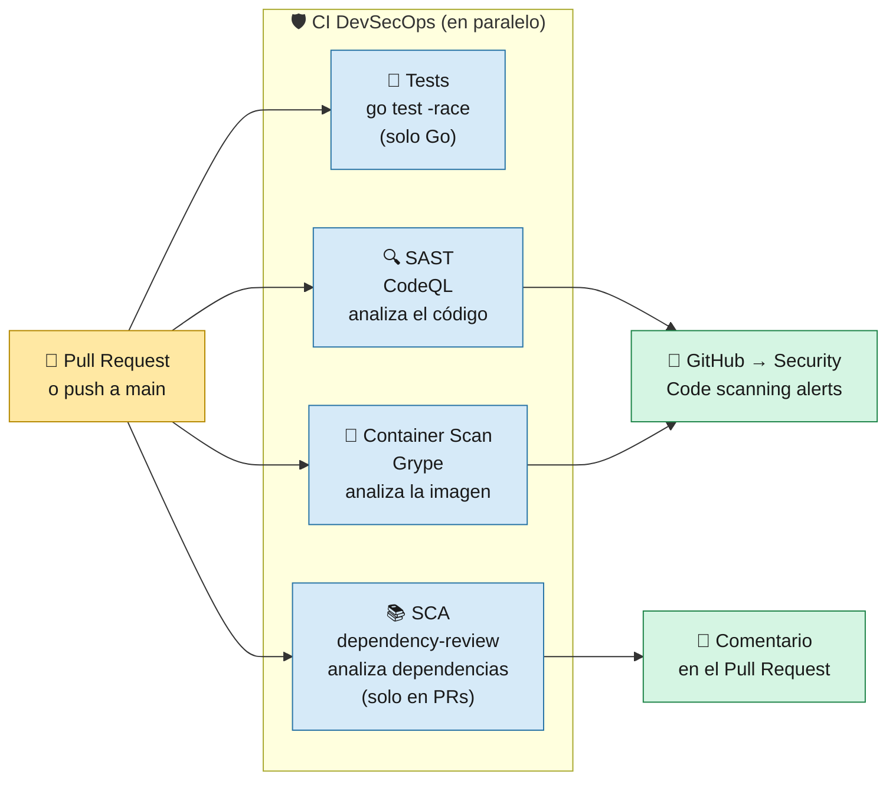
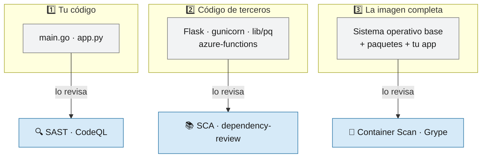

# 4 · Pipeline CI DevSecOps

> 🎯 **Objetivo:** entender cómo se revisa automáticamente la **calidad y la seguridad** del código antes de desplegarlo.

**DevSecOps** = meter la **seguridad** dentro del ciclo de desarrollo, de forma automática, en vez de dejarla para el final.

> 🛠️ **En clave de plataforma:** este CI es la capa de **seguridad por defecto** del *golden path* ([página 0](00-Ingenieria-de-Plataforma.md)). Ningún equipo tiene que configurar CodeQL ni Grype: quien sigue el golden path recibe los escaneos incluidos.

---

## 🔁 ¿Cuándo se ejecuta?

| Workflow | Se dispara con | Solo si cambian archivos en |
|----------|----------------|------------------------------|
| [`ci.yml`](../.github/workflows/ci.yml) — CI Python | push o Pull Request a `main`, o manual | `src/**` |
| [`ci-go.yml`](../.github/workflows/ci-go.yml) — CI Go | push o Pull Request a `main`, o manual | `src-go/**` |



---

## 🔍 Las tres capas de seguridad



| Capa | Herramienta | Qué busca | Ejemplo de hallazgo |
|------|-------------|-----------|---------------------|
| **SAST** (Static Application Security Testing) | GitHub **CodeQL**, queries `security-extended` | Errores de seguridad en **tu código** sin ejecutarlo | SQL injection en `/search` |
| **SCA** (Software Composition Analysis) | `actions/dependency-review-action` | Dependencias con **vulnerabilidades conocidas (CVE)** que añade el PR | Una versión vieja de Flask con CVE |
| **Container Scan** | **Anchore Grype** (`anchore/scan-action`) | Vulnerabilidades en la **imagen Docker** (SO base + paquetes) | `openssl` desactualizado en la imagen base |

---

## ⚙️ Jobs en detalle

| Job | Cuándo | Configuración clave |
|-----|--------|---------------------|
| `test` (solo Go) | Siempre | `go test -v -race ./...` — `-race` detecta condiciones de carrera |
| `SAST` | Siempre | Python: `build-mode: none` · Go: `autobuild` · sube resultados a GitHub Security |
| `SCA` | Solo en **Pull Requests** | `warn-only: true` (avisa pero no bloquea) · comenta el resumen en el PR |
| `Container_security` | Siempre | Construye el Dockerfile · `severity-cutoff: high` · `fail-build: false` · sube SARIF |

> 📝 **SARIF** es un formato estándar de resultados de análisis. GitHub lo entiende y muestra cada hallazgo en **Security → Code scanning** con el archivo y la línea.

### ¿Por qué no se rompe el pipeline si hay vulnerabilidades?

`warn-only: true` y `fail-build: false` están puestos **a propósito** para el curso: así puedes ver los hallazgos sin que el pipeline quede bloqueado. En un proyecto real normalmente se activaría el bloqueo:

```yaml
# Endurecer el Container Scan
fail-build: true
severity-cutoff: high

# Endurecer el SCA
fail-on-severity: high
```

---

## 👀 Dónde ver los resultados

| Resultado | Dónde |
|-----------|-------|
| Alertas de CodeQL y Grype | **Repositorio → Security → Code scanning** |
| Resumen de dependencias | Comentario automático en el **Pull Request** |
| Logs de cada job | **Actions → (ejecución) → (job)** |

➡️ Siguiente: [5 · Pipeline CD Despliegue](05-Pipeline-CD-Despliegue.md)
