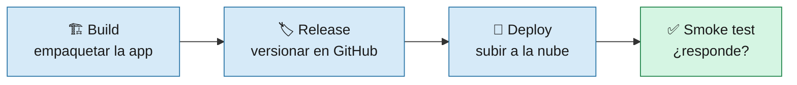
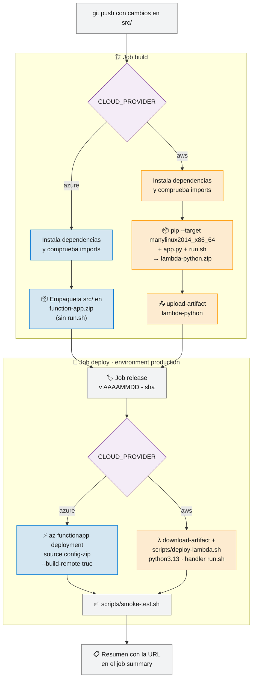
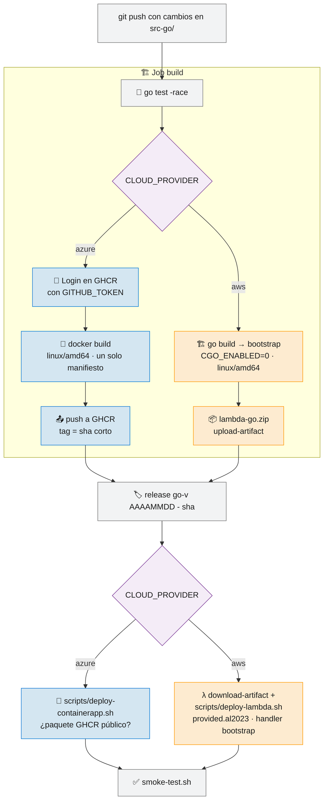
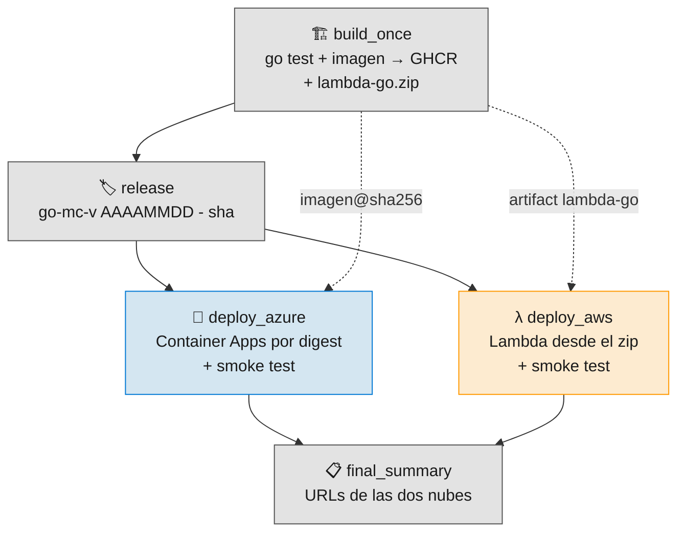
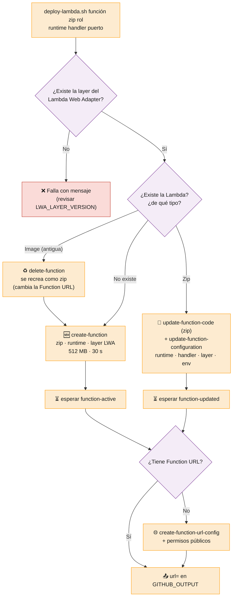
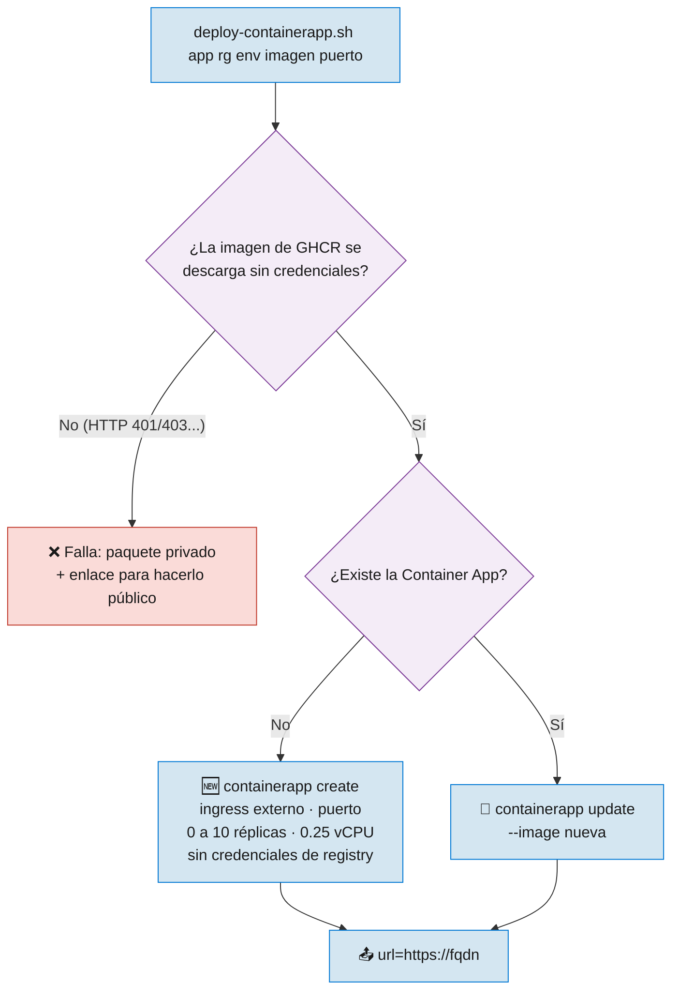
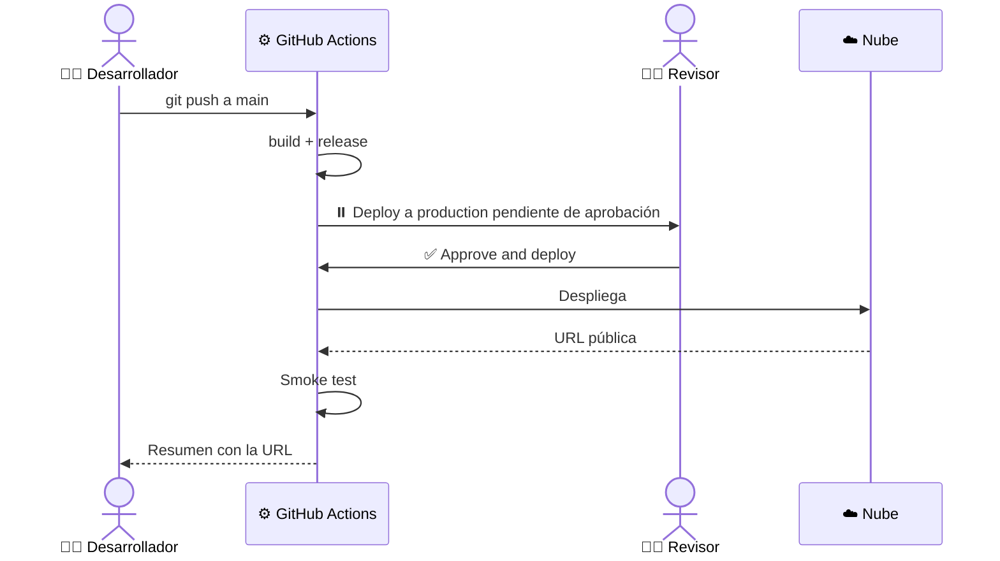

# 5 · Pipeline CD Despliegue

> 🎯 **Objetivo:** seguir el camino del código desde un `git push` hasta una URL pública en Azure o AWS.

**CD** (Continuous Delivery / Deployment) = cada cambio que llega a `main` se construye, se versiona y se despliega **automáticamente**.

---

## 🗂️ Los tres pipelines de CD

| Workflow | App | Se dispara con | Destino |
|----------|-----|----------------|---------|
| [`cd.yml`](../.github/workflows/cd.yml) | 🐍 Python | push a `main` con cambios en `src/`, o manual | `CLOUD_PROVIDER`: Azure Functions **o** Lambda |
| [`cd-go.yml`](../.github/workflows/cd-go.yml) | 🐹 Go | push a `main` con cambios en `src-go/`, o manual | `CLOUD_PROVIDER`: Container Apps **o** Lambda |
| [`cd-go-multicloud.yml`](../.github/workflows/cd-go-multicloud.yml) | 🐹 Go | Solo manual | Container Apps **y** Lambda a la vez |

Todos siguen la misma idea:

---

## 🐍 `cd.yml` — CD Python

> 🧠 **Remote build:** a Azure se sube solo el código. Azure instala las dependencias de `requirements.txt` en sus servidores, con el sistema operativo correcto.

> 📦 **En AWS el zip lleva las dependencias dentro:** el job `build` las instala con `pip --target` pidiendo wheels de Linux x86_64 para Python 3.13 (`--platform manylinux2014_x86_64 --only-binary=:all:`), así el paquete sirve en Lambda aunque se haya construido en otra máquina. El zip pasa al job `deploy` como **artifact** de GitHub Actions; el job `build` ya no necesita credenciales de AWS.

---

## 🐹 `cd-go.yml` — CD Go

- El job se llama `build` y su salida `artifact` es la referencia de la imagen (Azure) o el nombre del zip (AWS); aparece en la release y en el resumen.
- **Azure:** no hay registry en Azure. La imagen va a `ghcr.io/<owner-en-minúsculas>/<CONTAINER_NAME>-go:<sha_corto>`; el job tiene el permiso `packages: write` y se autentica con el `GITHUB_TOKEN`, sin secretos de la nube.
- **AWS:** no hay imagen ni ECR. El binario se llama `bootstrap` porque es lo que ejecuta el runtime `provided.al2023`.

> ⚠️ **Primera ejecución en Azure:** los paquetes de GHCR **nacen privados**, aunque el repo sea público, y Container Apps descarga la imagen **sin credenciales**. Antes de desplegar, `deploy-containerapp.sh` comprueba que la imagen se puede descargar de forma anónima; si no, el job falla con el mensaje *"el paquete de GHCR es privado"* y el enlace al paquete. Hazlo público **una sola vez** (*Package settings → Danger Zone → Change visibility → Public*) y relanza el workflow. Ver [7 · Configuración de GitHub](07-Configuracion-GitHub.md).

---

## 🌍 `cd-go-multicloud.yml` — Go en las dos nubes

Construye **una sola vez**, en un único job, los dos artefactos del mismo commit (la imagen para Azure y el zip para AWS) y despliega en paralelo:

- Usa el **mismo paquete de GHCR** que `cd-go.yml` (`<CONTAINER_NAME>-go`), así que también tiene que ser público.
- Azure despliega la imagen por **digest** (`imagen@sha256:...`), una huella única del contenido: Container Apps ejecuta exactamente la imagen construida en ese run, aunque alguien mueva el tag.
- Ya no hay pasos de "promote" a ACR/ECR ni un job que borre la imagen de GHCR al final: Container Apps vuelve a descargarla cada vez que **escala desde cero**, así que borrarla rompería la app.

---

## 🧰 Los scripts de despliegue

Los tres CD reutilizan los scripts de [`scripts/`](../scripts). Son **idempotentes**: puedes ejecutarlos muchas veces y el resultado es el mismo (crean la primera vez y actualizan después).

### `deploy-lambda.sh`

Las dos Lambdas reciben las variables `PORT`, `AWS_LWA_PORT`, `AWS_LWA_READINESS_CHECK_PATH=/health` y `ENVIRONMENT=production`; la de Python además `AWS_LAMBDA_EXEC_WRAPPER=/opt/bootstrap` (ver [3 · Aplicaciones](03-Aplicaciones.md)).

### `deploy-containerapp.sh`

### `smoke-test.sh`

Comprueba que `/health` contiene `healthy` y que `/` contiene `Hola ED Team`. Reintenta hasta 20 veces cada 10 segundos para dar tiempo al **cold start**.

---

## 🛑 Aprobación manual: environment `production`

Los jobs `deploy` de `cd.yml` y `cd-go.yml` usan el environment **`production`**. Si configuras revisores obligatorios, el pipeline **se pausa** hasta que alguien apruebe:

---

## 📋 ¿Dónde veo la URL de mi app?

Al terminar, cada pipeline escribe un **job summary** (Actions → la ejecución → Summary) con una tabla de URLs:

| Endpoint | URL |
|----------|-----|
| App | `https://…/` |
| Health check | `https://…/health` |

➡️ Siguiente: [6 · Infraestructura](06-Infraestructura.md)
