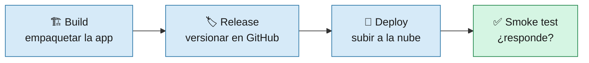
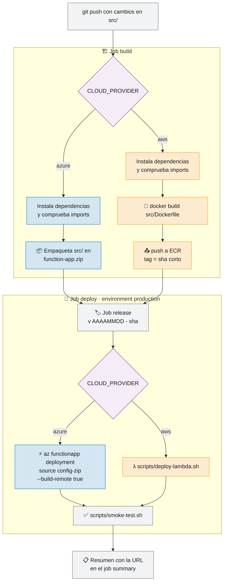
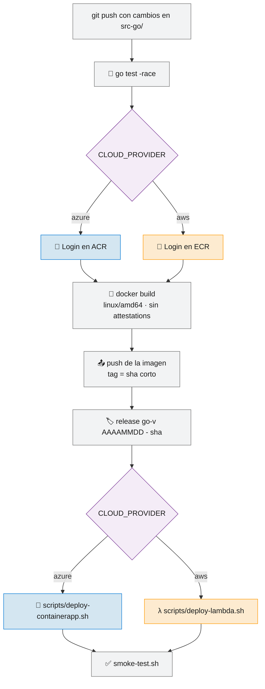
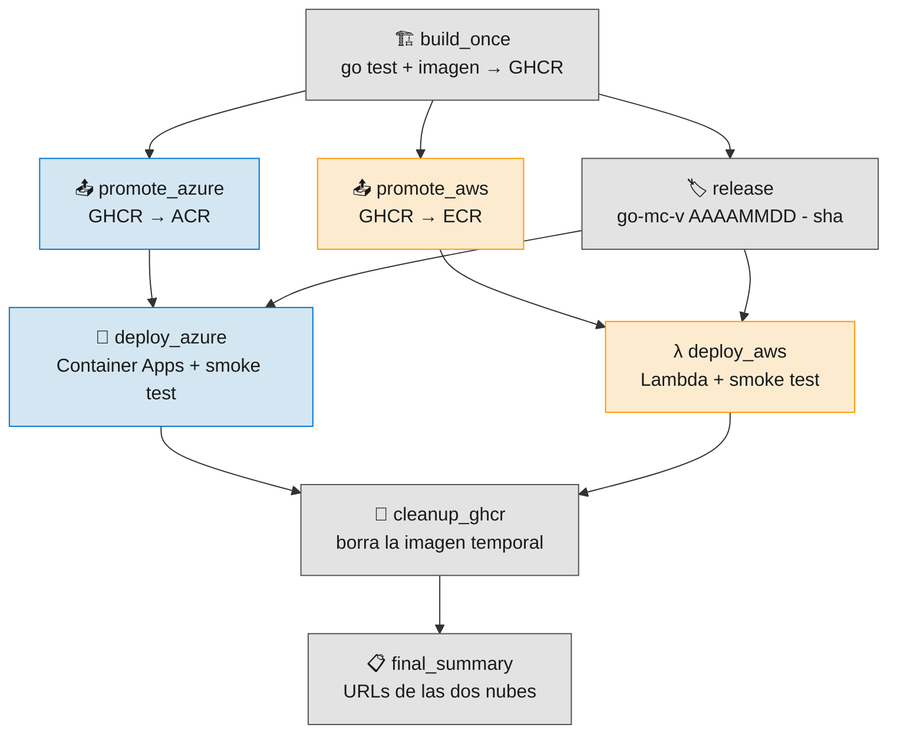
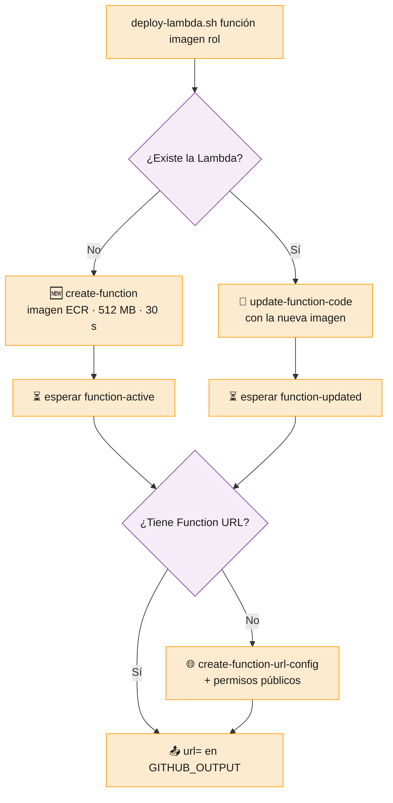
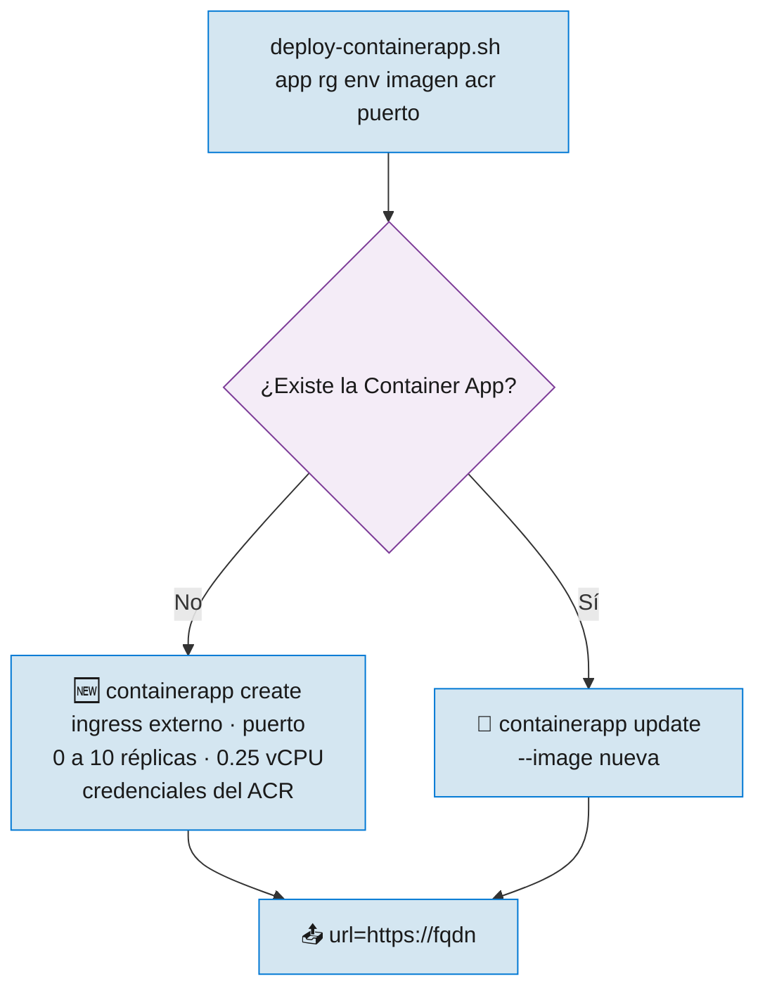
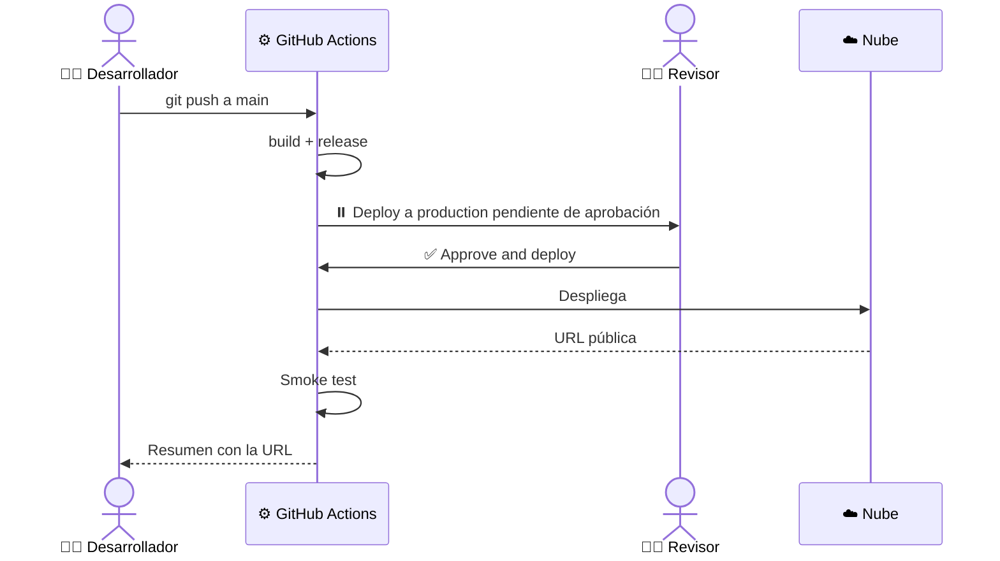

# 5 · Pipeline CD Despliegue

> 🎯 **Objetivo:** seguir el camino del código desde un `git push` hasta una URL pública en Azure o AWS.

**CD** (Continuous Delivery / Deployment) = cada cambio que llega a `main` se construye, se versiona y se despliega **automáticamente**.

---

## 🗂️ Los tres pipelines de CD

| Workflow | App | Se dispara con | Destino |
|----------|-----|----------------|---------|
| [`cd.yml`](../.github/workflows/cd.yml) | 🐍 Python | push a `main` con cambios en `src/`, o manual | `CLOUD_PROVIDER`: Azure Functions **o** Lambda |
| [`cd-go.yml`](../.github/workflows/cd-go.yml) | 🐹 Go | push a `main` con cambios en `src-go/`, o manual | `CLOUD_PROVIDER`: Container Apps **o** Lambda |
| [`cd-go-multicloud.yml`](../.github/workflows/cd-go-multicloud.yml) | 🐹 Go | Solo manual | Container Apps **y** Lambda a la vez |

Todos siguen la misma idea:

---

## 🐍 `cd.yml` — CD Python

> 🧠 **Remote build:** a Azure se sube solo el código. Azure instala las dependencias de `requirements.txt` en sus servidores, con el sistema operativo correcto.

---

## 🐹 `cd-go.yml` — CD Go

---

## 🌍 `cd-go-multicloud.yml` — Go en las dos nubes

Construye la imagen **una sola vez** y lleva **exactamente la misma** a Azure y a AWS:

> 🔐 La imagen se promueve por **digest** (`imagen@sha256:...`), una huella única del contenido. Así hay garantía de que Azure y AWS ejecutan **el mismo binario, byte a byte**.

---

## 🧰 Los scripts de despliegue

Los tres CD reutilizan los scripts de [`scripts/`](../scripts). Son **idempotentes**: puedes ejecutarlos muchas veces y el resultado es el mismo (crean la primera vez y actualizan después).

### `deploy-lambda.sh`

### `deploy-containerapp.sh`

### `smoke-test.sh`

Comprueba que `/health` contiene `healthy` y que `/` contiene `Hola ED Team`. Reintenta hasta 20 veces cada 10 segundos para dar tiempo al **cold start**.

---

## 🛑 Aprobación manual: environment `production`

Los jobs `deploy` de `cd.yml` y `cd-go.yml` usan el environment **`production`**. Si configuras revisores obligatorios, el pipeline **se pausa** hasta que alguien apruebe:

---

## 📋 ¿Dónde veo la URL de mi app?

Al terminar, cada pipeline escribe un **job summary** (Actions → la ejecución → Summary) con una tabla de URLs:

| Endpoint | URL |
|----------|-----|
| App | `https://…/` |
| Health check | `https://…/health` |

➡️ Siguiente: [6 · Infraestructura](06-Infraestructura.md)
