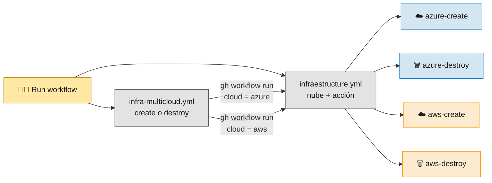
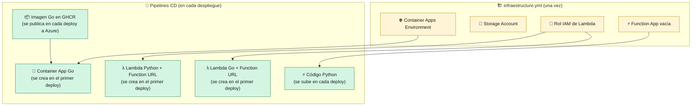
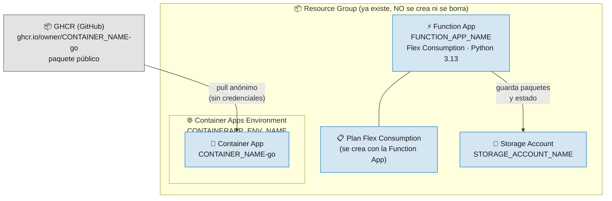
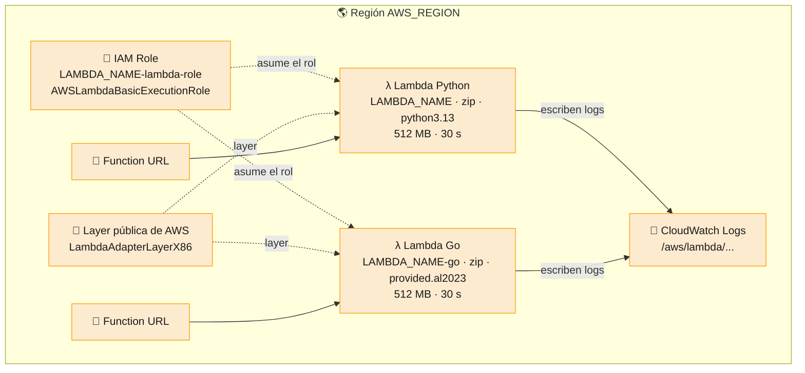

# 6 · Infraestructura

> 🎯 **Objetivo:** saber qué recursos se crean en cada nube, quién los crea y cómo se borran para no gastar dinero.

---

## ▶️ Los workflows de infraestructura

| Workflow | Cómo se lanza | Parámetros |
|----------|---------------|------------|
| [`infraestructure.yml`](../.github/workflows/infraestructure.yml) | Manual (Actions → *Provision Infrastructure (Serverless)* → Run workflow) | `cloud_provider`: `azure` / `aws` · `action`: `create` / `destroy` |
| [`infra-multicloud.yml`](../.github/workflows/infra-multicloud.yml) | Manual | `action`: `create` / `destroy`. Lanza `infraestructure.yml` para **Azure y AWS** a la vez |

---

## 🤝 ¿Quién crea cada recurso?

Hay recursos que **no se pueden crear sin el artefacto ya construido** (una Container App necesita saber qué imagen ejecutar y una Lambda, qué zip). Por eso el trabajo se reparte:

> 🧠 **No se crea ningún registry de contenedores** (ni ACR ni ECR): la imagen de Go vive en GitHub Container Registry (GHCR), que no hay que aprovisionar, y las Lambdas reciben paquetes zip.

---

## ☁️ Azure

| Paso de `azure-create` | Comando principal |
|------------------------|-------------------|
| 1. Verifica que existe el Resource Group | `az group show` |
| 2. Registra los resource providers necesarios | `az provider register` (`Microsoft.App`, `Microsoft.Web`, `Microsoft.Storage`) |
| 3. Crea el entorno de Container Apps | `az containerapp env create --logs-destination none` |
| 4. Crea la cuenta de almacenamiento | `az storage account create --sku Standard_LRS` |
| 5. Crea la Function App | `az functionapp create --flexconsumption-location … --runtime python` |

> 📌 El *summary* de `azure-create` recuerda el paso manual que queda: tras el primer CD de Go, hacer **público** el paquete `<CONTAINER_NAME>-go` de GHCR (una sola vez). Ver [7 · Configuración de GitHub](07-Configuracion-GitHub.md).

> 💡 Se desactivan **Log Analytics** y **Application Insights** para que el entorno sea barato y el `destroy` no deje recursos sueltos. Para el curso basta con los logs en streaming (ver [9 · Operación](09-Operacion-y-Troubleshooting.md)).

`azure-destroy` borra, en orden: Container App → Environment → Function App y su plan → Storage Account. **El Resource Group se conserva.** Las imágenes de GHCR **tampoco se borran**: si quieres eliminarlas, hazlo desde la pestaña *Packages* de GitHub.

---

## ☁️ AWS

| Paso de `aws-create` | Comando principal |
|----------------------|-------------------|
| 1. Crea el rol que asumirán las Lambdas | `aws iam create-role` + `attach-role-policy AWSLambdaBasicExecutionRole` |

Las Lambdas (con su paquete zip, la layer del Lambda Web Adapter y su Function URL) las crea el primer CD con [`deploy-lambda.sh`](../scripts/deploy-lambda.sh). La layer no se crea: la publica AWS en su cuenta `753240598075` y la función solo la referencia.

`aws-destroy` borra: las dos Lambdas (y con ellas sus Function URLs) → sus log groups → el rol IAM.

> 🧠 **Mínimo privilegio:** el rol de las Lambdas solo puede **escribir logs**. Si tu app no necesita nada más, no le des nada más.

---

## 💰 Costes y limpieza

| Recurso | ¿Cobra en reposo? |
|---------|-------------------|
| Azure Functions Flex Consumption | No (escala a cero) |
| Container Apps con `minReplicas 0` | No (escala a cero) |
| AWS Lambda | No |
| Storage Account | Céntimos por lo almacenado |
| GHCR (paquete público) | No: GitHub Packages es gratuito para paquetes públicos |

> ✅ **Buena práctica del curso:** cuando termines una sesión, ejecuta `infra-multicloud.yml` con `destroy`.

➡️ Siguiente: [7 · Configuración de GitHub](07-Configuracion-GitHub.md)
