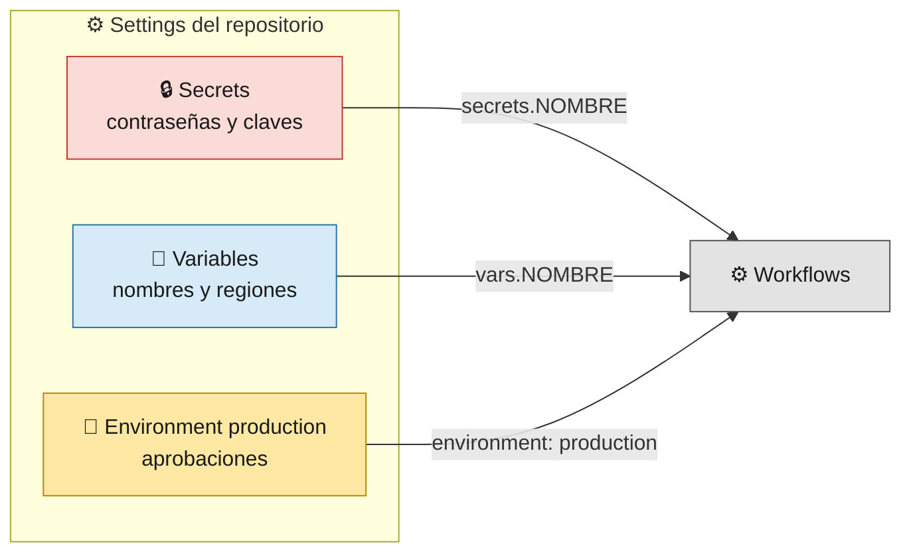
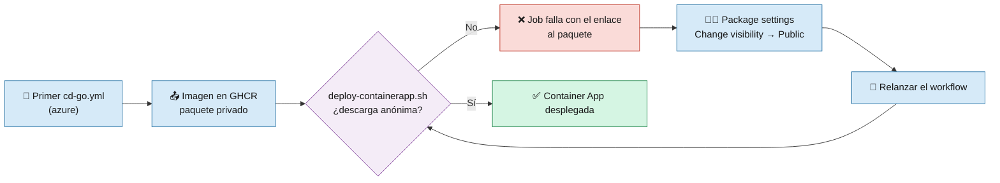

# 7 · Configuración de GitHub

> 🎯 **Objetivo:** dejar listos los **secrets**, **variables**, **permisos** y **environments** para que los pipelines funcionen.

Rutas en GitHub:
- **Settings → Secrets and variables → Actions** (pestañas *Secrets* y *Variables*)
- **Settings → Environments**
- **Settings → General → Features → Wikis** (para publicar esta wiki)
- **Packages → `<CONTAINER_NAME>-go` → Package settings** (hacer pública la imagen de Go, una sola vez)



> 🧠 **Secret vs variable:** un *secret* está cifrado y GitHub lo oculta en los logs (`***`). Una *variable* es texto normal. Nunca pongas contraseñas en variables.

---

## 1. 🔒 Secrets del repositorio

| Nombre | Para qué | Formato |
|--------|----------|---------|
| `AZURE_CREDENTIALS` | Azure (infra y deploy) | JSON |
| `AWS_ACCESS_KEY_ID` | AWS (infra y deploy) | texto |
| `AWS_SECRET_ACCESS_KEY` | AWS (infra y deploy) | texto |

> `GITHUB_TOKEN` lo genera GitHub automáticamente en cada ejecución; no hay que crearlo.

### Formato de `AZURE_CREDENTIALS`

```json
{
  "clientId": "xxxxxxxx-xxxx-xxxx-xxxx-xxxxxxxxxxxx",
  "clientSecret": "xxxxxxxxxxxxxxxxxxxxxxxxxxxxxxxx",
  "subscriptionId": "xxxxxxxx-xxxx-xxxx-xxxx-xxxxxxxxxxxx",
  "tenantId": "xxxxxxxx-xxxx-xxxx-xxxx-xxxxxxxxxxxx"
}
```

Archivo de referencia: [azure-credentials-example.json](azure-credentials-example.json)

Una forma de generarlo (con Azure CLI y permisos sobre el Resource Group):

```bash
az ad sp create-for-rbac \
  --name "sp-edteam-github" \
  --role Contributor \
  --scopes /subscriptions/<SUBSCRIPTION_ID>/resourceGroups/<RESOURCE_GROUP> \
  --json-auth
```

---

## 2. 🔑 Permisos necesarios

### Azure (Service Principal)

| Permiso | Por qué |
|---------|---------|
| **Contributor** sobre el Resource Group | Crear y borrar Container Apps, Storage y Function App |
| Registrar resource providers (nivel suscripción) | `Microsoft.App`, `Microsoft.Web`, `Microsoft.Storage`. Si el SP no puede, regístralos **una vez a mano**: `az provider register --namespace Microsoft.App` (y los demás) |

> 🧠 Azure **no** necesita credenciales de ningún registry: Container Apps descarga la imagen de GHCR de forma anónima (ver la sección 6 de esta página).

### AWS (usuario IAM)

| Servicio | Acciones |
|----------|----------|
| Lambda | crear/actualizar/borrar funciones (zip), su configuración, Function URLs y permisos (`AddPermission`); leer la layer del Lambda Web Adapter (`GetLayerVersion`) |
| IAM | crear/borrar el rol de Lambda, adjuntar políticas e `iam:PassRole` sobre ese rol |
| CloudWatch Logs | borrar log groups (en el destroy) |
| STS | `GetCallerIdentity` |

---

## 3. 📝 Variables del repositorio

| Nombre | Nube | Ejemplo | Para qué |
|--------|------|---------|----------|
| `CLOUD_PROVIDER` | ambas | `azure` o `aws` | A qué nube despliegan `cd.yml` y `cd-go.yml` |
| `RESOURCE_GROUP` | Azure | `rg-edteam-platform` | Resource Group **existente** |
| `AZURE_LOCATION` | Azure | `eastus` | Región (debe soportar Flex Consumption y Container Apps) |
| `CONTAINER_NAME` | Azure | `ed-team-app` | La Container App y el paquete de GHCR se llaman `<CONTAINER_NAME>-go` |
| `CONTAINERAPP_ENV_NAME` | Azure | `cae-edteam` | Container Apps Environment |
| `FUNCTION_APP_NAME` | Azure | `func-edteam-app` | Function App · único global (define la URL) |
| `STORAGE_ACCOUNT_NAME` | Azure | `stedteamfunc` | Único global · 3-24 minúsculas y números |
| `FUNCTION_PYTHON_VERSION` | Azure | `3.13` | Opcional (por defecto `3.13`) |
| `AWS_REGION` | AWS | `us-east-1` | Región |
| `LAMBDA_NAME` | AWS | `ed-team-app` | Nombre base: Lambda Python `<LAMBDA_NAME>`, Lambda Go `<LAMBDA_NAME>-go`, rol IAM `<LAMBDA_NAME>-lambda-role` |

Archivos de referencia: [azure-variables-example.json](azure-variables-example.json) · [aws-variables-example.json](aws-variables-example.json)

> ⚠️ **Nombres únicos globales:** `FUNCTION_APP_NAME` y `STORAGE_ACCOUNT_NAME` deben ser únicos **en todo Azure**. Añade tus iniciales o un número (`func-edteam-ana01`).

### ¿Qué variables usa cada workflow?

| Workflow | Variables y secrets |
|----------|---------------------|
| `ci.yml` · `ci-go.yml` | Ninguna variable cloud |
| `cd.yml` | `CLOUD_PROVIDER` · Azure: `RESOURCE_GROUP`, `FUNCTION_APP_NAME` · AWS: `AWS_REGION`, `LAMBDA_NAME` |
| `cd-go.yml` | `CLOUD_PROVIDER` · Azure: `RESOURCE_GROUP`, `CONTAINER_NAME`, `CONTAINERAPP_ENV_NAME` (+ `GITHUB_TOKEN` para GHCR) · AWS: `AWS_REGION`, `LAMBDA_NAME` |
| `cd-go-multicloud.yml` | Las de Azure **y** las de AWS |
| `infraestructure.yml` | Las de la nube elegida |
| `infra-multicloud.yml` | Las de Azure **y** las de AWS |
| `wiki.yml` | Ninguna (usa `GITHUB_TOKEN`) |

---

## 4. 🛑 Environments

Crea en **Settings → Environments**:

| Environment | Uso |
|-------------|-----|
| `production` | **Obligatorio.** Lo usan los jobs `deploy` de `cd.yml` y `cd-go.yml` |
| `desarrollo` | Opcional, para pruebas |

Configuración recomendada para `production`:

1. **Deployment branches:** solo `main`.
2. **Required reviewers:** al menos 1 persona que apruebe cada despliegue.
3. **Wait timer** (opcional): 5-10 minutos de margen antes de desplegar.
4. **Environment secrets:** no hacen falta; se usan los secrets del repositorio.

---

## 5. 📖 Wiki

Para que el workflow [Publicar Wiki](11-Publicar-la-Wiki.md) funcione:

1. **Settings → General → Features →** marca **Wikis**.
2. Entra en la pestaña **Wiki** del repositorio y crea **una primera página** cualquiera (GitHub no crea el repositorio de la wiki hasta entonces). El workflow la sobrescribirá.

---

## 6. 📦 Paquete de GHCR público (una sola vez)

La imagen de Go se publica en **GitHub Container Registry** como `ghcr.io/<owner-en-minúsculas>/<CONTAINER_NAME>-go`. El CD la sube con el `GITHUB_TOKEN` (permiso `packages: write` en el job), así que **no hay que crear ningún secret**. Pero Container Apps la descarga **sin credenciales**, y los paquetes de GHCR **nacen privados**, aunque el repo sea público.

Por eso, **tras la primera ejecución de `cd-go.yml` con `CLOUD_PROVIDER = azure`** (o de `cd-go-multicloud.yml`):

1. Abre el paquete `<CONTAINER_NAME>-go` (pestaña **Packages** de tu perfil o de la página principal del repo).
2. **Package settings → Danger Zone → Change visibility → Public** y confirma.
3. Relanza el workflow.



> 💡 Si el primer despliegue falla con *"el paquete de GHCR es privado"*, es justo esto: el script lo detecta **antes** de tocar Azure y no rompe nada. Es un paso manual que se hace una vez por paquete; los siguientes despliegues usan el mismo paquete. Solo es necesario si despliegas Go en Azure.

---

## ✅ Checklist final

- [ ] Secrets `AZURE_CREDENTIALS`, `AWS_ACCESS_KEY_ID`, `AWS_SECRET_ACCESS_KEY`
- [ ] Variables de la tabla (con nombres únicos donde toque)
- [ ] Environment `production` (solo `main` y con revisor)
- [ ] Wiki activada y con una primera página
- [ ] Lanzar `infraestructure.yml` con `create` para validar credenciales
- [ ] Lanzar `cd.yml` y `cd-go.yml`: el *job summary* muestra la URL pública
- [ ] Tras el primer `cd-go.yml` en Azure: paquete `<CONTAINER_NAME>-go` de GHCR en **Public**

➡️ Siguiente: [8 · Laboratorio paso a paso](08-Laboratorio-Paso-a-Paso.md)
