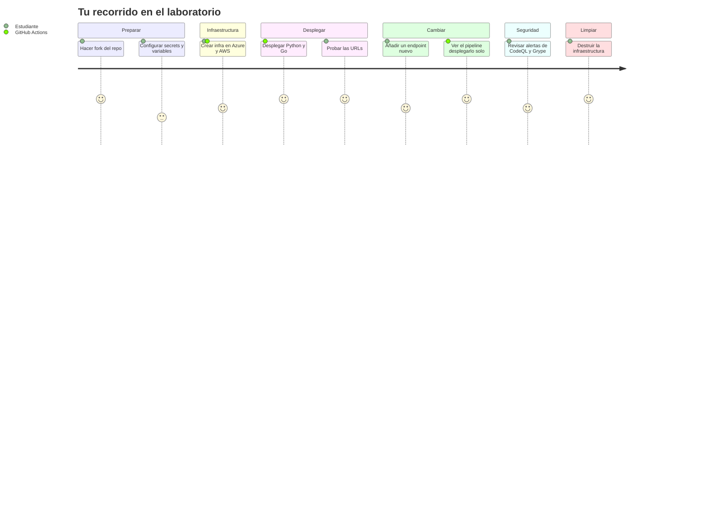
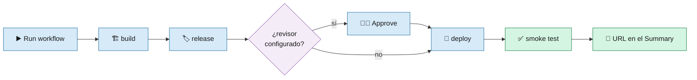

# 8 · 🧪 Laboratorio paso a paso

> 🎯 **Objetivo:** llevar las dos apps a producción en Azure y AWS, hacer un cambio y verlo desplegado, y dejarlo todo limpio al final.

⏱️ Duración aproximada: 60-90 minutos.

---

## 🧭 El recorrido

```mermaid
flowchart LR
    P0["0️⃣ Requisitos"] --> P1["1️⃣ Fork"] --> P2["2️⃣ Configurar"] --> P3["3️⃣ Infra"] --> P4["4️⃣ Deploy"] --> P5["5️⃣ Probar"] --> P6["6️⃣ Cambiar"] --> P7["7️⃣ Otra nube"] --> P8["8️⃣ Seguridad"] --> P9["9️⃣ Limpiar"]

    classDef s fill:#D6EAF8,stroke:#2874A6,color:#1a1a1a
    classDef end9 fill:#D5F5E3,stroke:#1E8449,color:#1a1a1a
    class P0,P1,P2,P3,P4,P5,P6,P7,P8 s
    class P9 end9
```





---

## 0️⃣ Requisitos

- Cuenta de **GitHub**.
- Suscripción de **Azure** con un **Resource Group** donde tengas permisos.
- Cuenta de **AWS** con un usuario IAM (access key).
- Opcional en tu máquina: `git`, `curl`, Azure CLI (`az`), AWS CLI (`aws`), Go y `uv`.

## 1️⃣ Haz fork del repositorio

1. Botón **Fork** en GitHub.
2. En tu fork: **Actions → I understand my workflows, go ahead and enable them**.

## 2️⃣ Configura secrets, variables y environment

Sigue [7 · Configuración de GitHub](07-Configuracion-GitHub.md). Empieza con:

```text
CLOUD_PROVIDER = azure
```

> ✅ **Checkpoint:** en *Settings → Secrets and variables → Actions* ves 3 secrets y todas las variables.

## 3️⃣ Crea la infraestructura

1. **Actions → Infrastructure - Multi Cloud → Run workflow → action: `create`**.
2. Se lanzan dos ejecuciones de *Provision Infrastructure (Serverless)*: una para Azure y otra para AWS.
3. Abre cada una y mira el **Summary**.

> ✅ **Checkpoint:** el summary de Azure muestra el ACR, el Container Apps Environment y la Function App. El de AWS muestra los dos repos ECR y el rol IAM.

## 4️⃣ Despliega las apps

1. **Actions → CD - Python (Serverless) → Run workflow**.
2. **Actions → CD - Go (Serverless) → Run workflow**.
3. Si configuraste revisores en `production`, pulsa **Review deployments → Approve and deploy**.



> ✅ **Checkpoint:** los dos workflows terminan en verde y el **Summary** muestra la URL de cada app.

## 5️⃣ Prueba las URLs

```bash
curl https://<tu-function-app>.azurewebsites.net/
curl https://<tu-function-app>.azurewebsites.net/health
curl https://<tu-container-app>.<región>.azurecontainerapps.io/
```

🔬 **Experimento del cold start:** espera 15-20 minutos sin usar la app y mide:

```bash
time curl -s https://<url>/health    # primera vez: más lento (cold start)
time curl -s https://<url>/health    # segunda vez: rápido
```

## 6️⃣ Haz un cambio y míralo desplegarse solo

Añade un endpoint `/version` a la app Go en [`src-go/main.go`](../src-go/main.go):

```go
http.HandleFunc("/version", func(w http.ResponseWriter, r *http.Request) {
    w.Header().Set("Content-Type", "application/json")
    json.NewEncoder(w).Encode(map[string]string{"version": "v2"})
})
```

```bash
git add src-go/main.go
git commit -m "feat: endpoint /version"
git push
```

> ✅ **Checkpoint:** se ejecutan **CI - Go** y **CD - Go (Serverless)** solos. Al terminar, `curl https://<url>/version` devuelve `{"version":"v2"}`.

> ⚠️ **Ojo:** si cambias el mensaje `Hola ED Team`, fallarán los tests de Go **y** el smoke test (los dos comprueban ese texto). ¡Pruébalo para ver cómo el pipeline te protege de desplegar algo roto!

## 7️⃣ Despliega en la otra nube

1. Cambia la variable `CLOUD_PROVIDER` a `aws`.
2. Vuelve a lanzar **CD - Python** y **CD - Go**.
3. Ahora las URLs son del tipo `https://xxxx.lambda-url.us-east-1.on.aws/`.

**Bonus:** lanza **CD Go Multi-Cloud Manual (Serverless)** y compara las dos URLs en el *final summary*: la **misma** imagen corre en Azure y en AWS.

## 8️⃣ Revisa la seguridad

1. **Security → Code scanning**: verás alertas de CodeQL en `src-go/main.go` (SQL injection, command injection, credenciales en el código).
2. Abre una alerta y lee la explicación y la línea señalada.
3. Lee [10 · Seguridad](10-Seguridad.md) para entender por qué están ahí.

## 9️⃣ Limpia todo 🧹

**Actions → Infrastructure - Multi Cloud → Run workflow → action: `destroy`**.

> ✅ **Checkpoint final:** en el portal de Azure tu Resource Group está vacío (o solo con lo que ya tenías) y en AWS no quedan Lambdas ni repos ECR del curso.

---

## 🏆 Retos extra

| Reto | Pista |
|------|-------|
| Haz que el Container Scan **rompa** el pipeline si hay vulnerabilidades HIGH | `fail-build: true` en `ci.yml` / `ci-go.yml` |
| Pon la app Go con **1 réplica mínima** para evitar el cold start | `--min-replicas 1` en `scripts/deploy-containerapp.sh` (¡ojo, ya cobra en reposo!) |
| Sube la memoria de las Lambdas a 1024 MB y compara el cold start | `--memory-size` en `scripts/deploy-lambda.sh` (solo aplica al crear; usa `update-function-configuration` para una existente) |
| Añade un test en Python | Crea `src/test_app.py` con el test client de Flask y añádelo al `build` de `cd.yml` |

➡️ Siguiente: [9 · Operación y Troubleshooting](09-Operacion-y-Troubleshooting.md)
