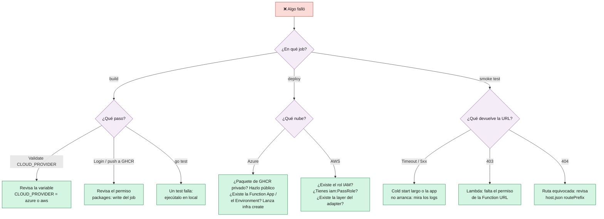

# 9 · Operación y Troubleshooting

> 🎯 **Objetivo:** tener a mano los comandos para inspeccionar las apps y saber qué hacer cuando algo falla.

---

## 🔎 Ver URLs y estado

```bash
# ⚡ Azure Functions (Python)
az functionapp show -g <RESOURCE_GROUP> -n <FUNCTION_APP_NAME> \
  --query "{url:properties.defaultHostName, estado:properties.state}"

# 🐳 Azure Container Apps (Go)
az containerapp show -g <RESOURCE_GROUP> -n <CONTAINER_NAME>-go \
  --query "{url:properties.configuration.ingress.fqdn, revision:properties.latestRevisionName, imagen:properties.template.containers[0].image}"

# λ AWS Lambda (Python y Go)
aws lambda get-function-url-config --function-name <LAMBDA_NAME>    --query FunctionUrl
aws lambda get-function-url-config --function-name <LAMBDA_NAME>-go --query FunctionUrl
aws lambda get-function --function-name <LAMBDA_NAME>-go \
  --query "Configuration.{estado:State, ultimaActualizacion:LastUpdateStatus, tipo:PackageType, runtime:Runtime, layers:Layers[].Arn}"
```

## 🧪 Probar endpoints

```bash
bash scripts/smoke-test.sh https://<url>      # el mismo test que usa el pipeline
curl -i https://<url>/health                  # -i muestra el código HTTP y cabeceras
```

## 📜 Logs

```bash
# 🐳 Container Apps: logs de consola en streaming
az containerapp logs show -g <RESOURCE_GROUP> -n <CONTAINER_NAME>-go --follow

# λ Lambda: logs de CloudWatch en streaming
aws logs tail /aws/lambda/<LAMBDA_NAME>-go --follow
```

> ⚡ **Azure Functions:** Application Insights está desactivado para simplificar la limpieza. Si necesitas logs, crea un recurso de Application Insights y añade su cadena de conexión a la Function App como app setting `APPLICATIONINSIGHTS_CONNECTION_STRING`.

## 🚀 Desplegar a mano (sin GitHub Actions)

```bash
# Python → Azure Functions
cd src && zip -r ../function-app.zip . -x 'Dockerfile' '.funcignore' 'run.sh' '__pycache__/*' '*.pyc' && cd ..
az functionapp deployment source config-zip -g <RESOURCE_GROUP> -n <FUNCTION_APP_NAME> \
  --src function-app.zip --build-remote true

# Go → Container Apps (con una imagen ya subida a GHCR y el paquete en público)
bash scripts/deploy-containerapp.sh <CONTAINER_NAME>-go <RESOURCE_GROUP> <CONTAINERAPP_ENV_NAME> \
  ghcr.io/<owner-en-minúsculas>/<CONTAINER_NAME>-go:<tag> 8080

# Go → Lambda (zip con el binario bootstrap)
(cd src-go && CGO_ENABLED=0 GOOS=linux GOARCH=amd64 go build -o ../build/bootstrap .)
(cd build && zip -q ../lambda-go.zip bootstrap)
bash scripts/deploy-lambda.sh <LAMBDA_NAME>-go lambda-go.zip <LAMBDA_NAME>-lambda-role provided.al2023 bootstrap 8080
```

> 🐍 Para la **Lambda Python** el zip lleva dentro las dependencias compiladas para Linux x86_64: lo más fiable es generarlo con el paso *Package AWS Lambda* de [`cd.yml`](../.github/workflows/cd.yml) y luego `deploy-lambda.sh <LAMBDA_NAME> lambda-python.zip <LAMBDA_NAME>-lambda-role python3.13 run.sh 5000`. La versión de la layer del Lambda Web Adapter se cambia con la variable de entorno `LWA_LAYER_VERSION` (por defecto `30`).

---

## 🩺 ¿Qué está fallando? Árbol de diagnóstico



## 🧯 Errores típicos

| Síntoma | Causa probable | Solución |
|---------|----------------|----------|
| `CLOUD_PROVIDER debe ser 'azure' o 'aws'` | Variable vacía o mal escrita | Crea/corrige la variable `CLOUD_PROVIDER` |
| `Resource Group not found` | `RESOURCE_GROUP` no existe o el SP no lo ve | Crea el RG o revisa el scope del Service Principal |
| `The subscription is not registered to use namespace 'Microsoft.App'` | Provider sin registrar | `az provider register --namespace Microsoft.App` con un usuario con permisos de suscripción |
| `... name is already taken` / `AlreadyExists` | `FUNCTION_APP_NAME` o `STORAGE_ACCOUNT_NAME` usados por otra persona | Elige otro nombre único |
| `az functionapp create` falla con la versión de Python | La región no ofrece esa versión en Flex Consumption | Pon `FUNCTION_PYTHON_VERSION=3.12` **y** cambia `azure-functions` a `1.x` en `requirements.txt` |
| `La imagen ghcr.io/... no se puede descargar sin credenciales (HTTP 401 o 403): el paquete de GHCR es privado` | Los paquetes de GHCR nacen privados y Container Apps descarga la imagen sin credenciales | Abre el enlace del log → **Package settings → Danger Zone → Change visibility → Public** y relanza (ver [7 · Configuración de GitHub](07-Configuracion-GitHub.md)) |
| Push a GHCR: `denied` / `permission_denied` | El job no tiene `packages: write`, o el paquete ya existe ligado a otro repo | Revisa los `permissions` del job; en *Package settings → Manage Actions access* da acceso de escritura a este repo |
| Lambda: `No se encuentra la layer del Lambda Web Adapter: arn:aws:lambda:...` | Esa versión de `LambdaAdapterLayerX86` no está en tu región, o el usuario IAM no puede leer layers | Mira la versión vigente en [aws-lambda-web-adapter](https://github.com/aws/aws-lambda-web-adapter) y pásala en `LWA_LAYER_VERSION`; revisa `lambda:GetLayerVersion` |
| Lambda: `No existe el paquete lambda-*.zip` | El zip no llegó al job `deploy` (por ejemplo, se cambió `CLOUD_PROVIDER` y se relanzó solo el deploy) | Relanza el workflow **completo**, no solo el job fallido |
| Lambda Python no arranca (en los logs: `ModuleNotFoundError` o `Permission denied` en `run.sh`) | El zip no lleva las dependencias para Linux x86_64 o `run.sh` no es ejecutable | Genera el zip como en `cd.yml` (`pip --target` con `manylinux2014_x86_64` y `chmod +x run.sh`) |
| La Function URL de una Lambda **cambió** | La Lambda existía como imagen de contenedor y `deploy-lambda.sh` la borró y recreó como zip | Normal, solo pasa una vez: usa la nueva URL del *Summary* |
| Lambda: `AccessDeniedException ... iam:PassRole` | El usuario IAM no puede pasar el rol | Añade `iam:PassRole` sobre `<LAMBDA_NAME>-lambda-role` |
| Lambda: `The role defined for the function cannot be assumed` | El rol se acaba de crear y aún no se ha propagado | Espera 1 minuto y relanza el CD |
| Function URL devuelve **403** | Faltan permisos públicos de la Function URL | En la consola de Lambda → *Configuration → Function URL*, o añade `lambda:InvokeFunction` con condición `lambda:InvokedViaFunctionUrl` |
| Azure Functions devuelve **404** en `/health` | Se perdió `routePrefix: ""` y la ruta real es `/api/health` | Revisa `src/host.json` |
| Smoke test agota los intentos | Cold start muy largo o la app no arranca | Mira los logs; relanza el job |
| El pipeline se queda en *Waiting* | Environment `production` con revisor obligatorio | **Review deployments → Approve** |

➡️ Siguiente: [10 · Seguridad](10-Seguridad.md)
