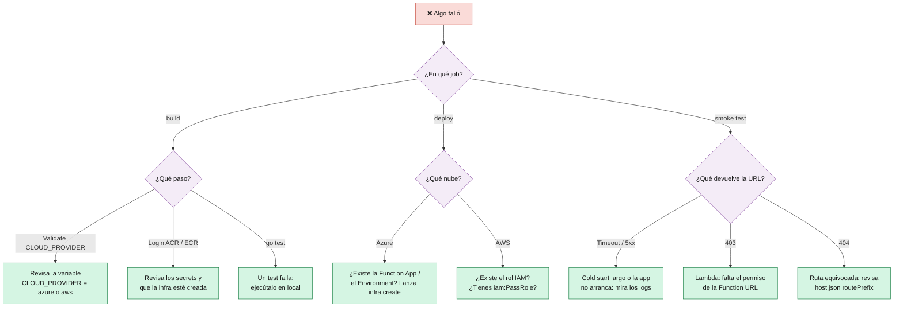

# 9 · Operación y Troubleshooting

> 🎯 **Objetivo:** tener a mano los comandos para inspeccionar las apps y saber qué hacer cuando algo falla.

---

## 🔎 Ver URLs y estado

```bash
# ⚡ Azure Functions (Python)
az functionapp show -g <RESOURCE_GROUP> -n <FUNCTION_APP_NAME> \
  --query "{url:defaultHostName, estado:state}"

# 🐳 Azure Container Apps (Go)
az containerapp show -g <RESOURCE_GROUP> -n <CONTAINER_NAME>-go \
  --query "{url:properties.configuration.ingress.fqdn, revision:properties.latestRevisionName, imagen:properties.template.containers[0].image}"

# λ AWS Lambda (Python y Go)
aws lambda get-function-url-config --function-name <ECR_REPOSITORY_NAME>    --query FunctionUrl
aws lambda get-function-url-config --function-name <ECR_REPOSITORY_NAME>-go --query FunctionUrl
aws lambda get-function --function-name <ECR_REPOSITORY_NAME>-go \
  --query "Configuration.{estado:State, ultimaActualizacion:LastUpdateStatus}"
```

## 🧪 Probar endpoints

```bash
bash scripts/smoke-test.sh https://<url>      # el mismo test que usa el pipeline
curl -i https://<url>/health                  # -i muestra el código HTTP y cabeceras
```

## 📜 Logs

```bash
# 🐳 Container Apps: logs de consola en streaming
az containerapp logs show -g <RESOURCE_GROUP> -n <CONTAINER_NAME>-go --follow

# λ Lambda: logs de CloudWatch en streaming
aws logs tail /aws/lambda/<ECR_REPOSITORY_NAME>-go --follow
```

> ⚡ **Azure Functions:** Application Insights está desactivado para simplificar la limpieza. Si necesitas logs, crea un recurso de Application Insights y añade su cadena de conexión a la Function App como app setting `APPLICATIONINSIGHTS_CONNECTION_STRING`.

## 🚀 Desplegar a mano (sin GitHub Actions)

```bash
# Python → Azure Functions
cd src && zip -r ../function-app.zip . -x 'Dockerfile' '.funcignore' '__pycache__/*' '*.pyc' && cd ..
az functionapp deployment source config-zip -g <RESOURCE_GROUP> -n <FUNCTION_APP_NAME> \
  --src function-app.zip --build-remote true

# Go → Container Apps (con una imagen ya subida al ACR)
bash scripts/deploy-containerapp.sh <CONTAINER_NAME>-go <RESOURCE_GROUP> <CONTAINERAPP_ENV_NAME> \
  <REGISTRY_NAME>.azurecr.io/<CONTAINER_NAME>-go:<tag> <REGISTRY_NAME> 8080

# Go → Lambda (con una imagen ya subida a ECR)
bash scripts/deploy-lambda.sh <ECR_REPOSITORY_NAME>-go <imagen-ecr> <ECR_REPOSITORY_NAME>-lambda-role
```

---

## 🩺 ¿Qué está fallando? Árbol de diagnóstico



## 🧯 Errores típicos

| Síntoma | Causa probable | Solución |
|---------|----------------|----------|
| `CLOUD_PROVIDER debe ser 'azure' o 'aws'` | Variable vacía o mal escrita | Crea/corrige la variable `CLOUD_PROVIDER` |
| `Resource Group not found` | `RESOURCE_GROUP` no existe o el SP no lo ve | Crea el RG o revisa el scope del Service Principal |
| `The subscription is not registered to use namespace 'Microsoft.App'` | Provider sin registrar | `az provider register --namespace Microsoft.App` con un usuario con permisos de suscripción |
| `... name is already taken` / `AlreadyExists` | `REGISTRY_NAME`, `FUNCTION_APP_NAME` o `STORAGE_ACCOUNT_NAME` usados por otra persona | Elige otro nombre único |
| `az functionapp create` falla con la versión de Python | La región no ofrece esa versión en Flex Consumption | Pon `FUNCTION_PYTHON_VERSION=3.12` **y** cambia `azure-functions` a `1.x` en `requirements.txt` |
| Lambda: `The image manifest, config or layer media type ... is not supported` | La imagen tiene attestations o es de otra arquitectura | Construye con `--platform linux/amd64 --provenance=false --sbom=false` |
| Lambda: `AccessDeniedException ... iam:PassRole` | El usuario IAM no puede pasar el rol | Añade `iam:PassRole` sobre `<ECR_REPOSITORY_NAME>-lambda-role` |
| Lambda: `The role defined for the function cannot be assumed` | El rol se acaba de crear y aún no se ha propagado | Espera 1 minuto y relanza el CD |
| Function URL devuelve **403** | Faltan permisos públicos de la Function URL | En la consola de Lambda → *Configuration → Function URL*, o añade `lambda:InvokeFunction` con condición `lambda:InvokedViaFunctionUrl` |
| Azure Functions devuelve **404** en `/health` | Se perdió `routePrefix: ""` y la ruta real es `/api/health` | Revisa `src/host.json` |
| Smoke test agota los intentos | Cold start muy largo o la app no arranca | Mira los logs; relanza el job |
| El pipeline se queda en *Waiting* | Environment `production` con revisor obligatorio | **Review deployments → Approve** |

➡️ Siguiente: [10 · Seguridad](10-Seguridad.md)
