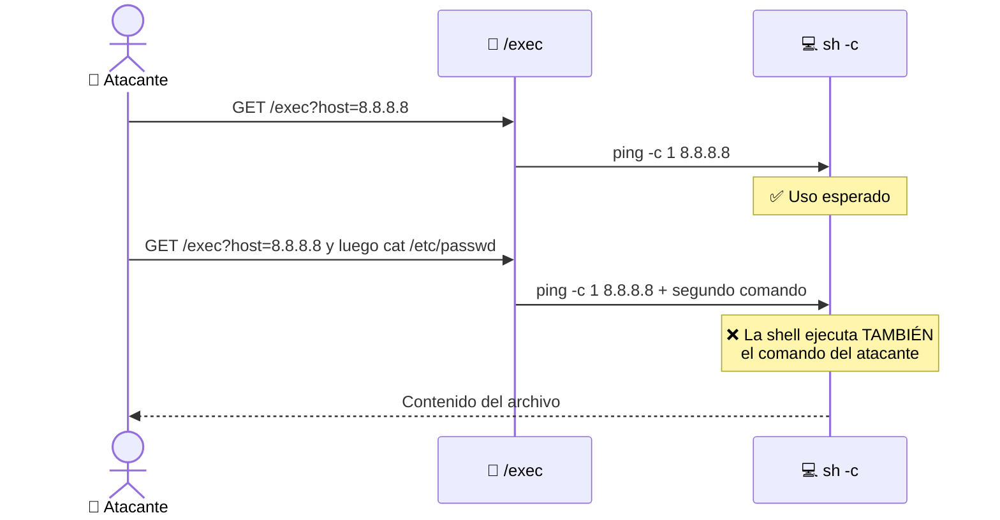

# 10 · Seguridad

> 🎯 **Objetivo:** conocer los controles de seguridad del proyecto y entender las vulnerabilidades **de ejemplo** que contiene.

---

## 🛡️ Defensa en capas

```mermaid
flowchart LR
    subgraph CODE["💻 Código"]
        A1["🔍 CodeQL SAST"]
        A2["📚 Dependency review SCA"]
    end
    subgraph IMAGE["🐳 Imagen"]
        B1["🔎 Grype en CI"]
        B2["🔎 ECR scanOnPush"]
        B3["👤 Usuario no root"]
        B4["📦 Multi-stage mínima"]
    end
    subgraph PIPE["⚙️ Pipeline"]
        C1["🔒 Secrets cifrados"]
        C2["🙈 Contraseña ACR enmascarada"]
        C3["🛑 Aprobación en production"]
        C4["🔐 Promote por digest"]
    end
    subgraph CLOUD["☁️ Nube"]
        D1["🔑 Rol IAM mínimo"]
        D2["🔒 HTTPS incluido"]
        D3["🚫 Storage sin acceso público"]
    end

    CODE --> IMAGE --> PIPE --> CLOUD

    classDef c fill:#D6EAF8,stroke:#2874A6,color:#1a1a1a
    classDef i fill:#FDEBD0,stroke:#CA6F1E,color:#1a1a1a
    classDef p fill:#E3E3E3,stroke:#555,color:#1a1a1a
    classDef k fill:#D5F5E3,stroke:#1E8449,color:#1a1a1a
    class A1,A2 c
    class B1,B2,B3,B4 i
    class C1,C2,C3,C4 p
    class D1,D2,D3 k
```

| Control | Mecanismo | Dónde |
|---------|-----------|-------|
| SAST | CodeQL `security-extended` | `ci.yml`, `ci-go.yml` |
| SCA | `dependency-review-action` | PRs |
| Escaneo de imagen | Anchore Grype → SARIF | `ci.yml`, `ci-go.yml` |
| Escaneo en el registro | ECR `scanOnPush=true` | `infraestructure.yml` |
| Contenedor sin root | `USER appuser` (uid 1000) | Dockerfiles |
| Imagen mínima | Multi-stage (Go) y `-slim` (Python) | Dockerfiles |
| Mínimo privilegio | Rol Lambda solo con `AWSLambdaBasicExecutionRole` | `infraestructure.yml` |
| Secretos fuera del código | GitHub Secrets | Todos los workflows |
| Enmascarado en logs | `::add-mask::` para la contraseña del ACR | `scripts/deploy-containerapp.sh` |
| Integridad de la imagen | Promote por digest GHCR → ACR/ECR | `cd-go-multicloud.yml` |
| Aprobación humana | Environment `production` | `cd.yml`, `cd-go.yml` |
| Storage privado | `--allow-blob-public-access false` | `infraestructure.yml` |

---

## 🐞 Vulnerabilidades intencionales en `src-go/main.go`

El archivo [`src-go/main.go`](../src-go/main.go) tiene **errores de seguridad puestos a propósito** para que veas a CodeQL detectarlos. **No copies este código en un proyecto real.**

| Tipo | Dónde | CWE | Por qué es peligroso |
|------|-------|-----|----------------------|
| Credenciales en el código | Constantes `API_KEY`, `API_SECRET`, `DB_PASSWORD` | CWE-798 | Quien lea el repo (o la imagen) obtiene las claves |
| SQL Injection | Endpoint `/search?username=` | CWE-89 | El texto del usuario se pega dentro de la consulta SQL |
| Command Injection | Endpoint `/exec?host=` | CWE-78 | El texto del usuario se ejecuta en una shell |

### Cómo funciona un Command Injection

### Cómo se arreglaría (para que lo practiques en una rama)

| Vulnerabilidad | Corrección |
|----------------|------------|
| Credenciales | Leerlas de variables de entorno o de un gestor de secretos (Key Vault, Secrets Manager) |
| SQL Injection | Consultas parametrizadas: `db.Query("SELECT ... WHERE name = $1", username)` |
| Command Injection | No usar `sh -c`; validar la entrada y pasar argumentos separados: `exec.Command("ping", "-c", "1", host)` |

> ⚠️ **Importante:** estos endpoints quedan **expuestos en las URLs públicas** de Container Apps y Lambda. `/exec` permite ejecutar comandos dentro del entorno de la app. Por eso: **destruye la infraestructura al terminar cada sesión** y no reutilices estas cuentas para nada importante.

---

## 🔧 Configuración de los escáneres

| Escáner | Configuración en el curso | En producción real |
|---------|---------------------------|--------------------|
| Grype | `fail-build: false`, `severity-cutoff: high` | `fail-build: true` |
| Dependency review | `warn-only: true` | `fail-on-severity: high` |
| CodeQL | Reporta, no bloquea | Regla de protección de rama que exija resolver alertas |

Los hallazgos aparecen en **Security → Code scanning**.

➡️ Siguiente: [11 · Publicar la Wiki](11-Publicar-la-Wiki.md)
