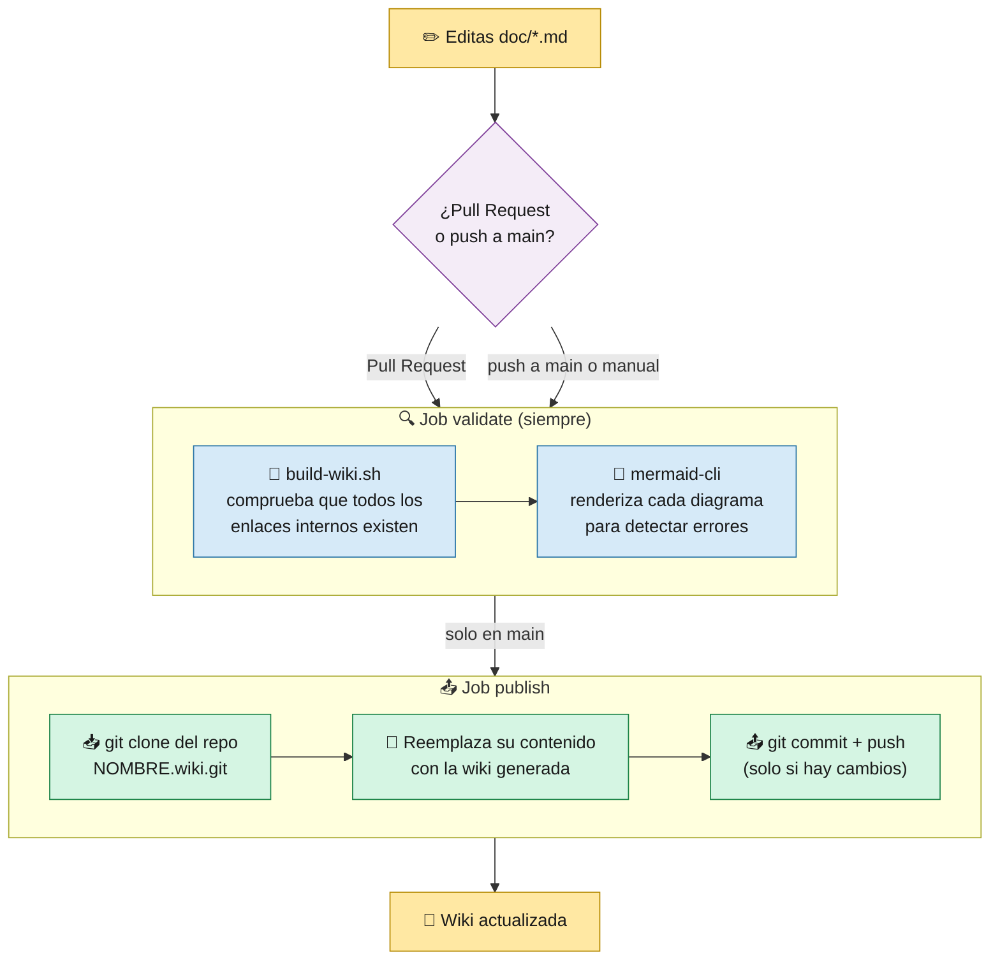

# 11 · Publicar la Wiki

> 🎯 **Objetivo:** entender cómo esta documentación pasa de la carpeta `doc/` a la **Wiki de GitHub** de forma automática ("docs as code").

---

## 📖 Docs as code

La documentación vive **en el mismo repositorio que el código**, en [`doc/`](.). Así:

- se revisa en Pull Requests como cualquier cambio,
- tiene historial en git,
- y un pipeline la publica en la Wiki automáticamente.

> ✏️ **Nunca edites la Wiki directamente desde GitHub**: el siguiente despliegue sobrescribirá tus cambios. Edita los archivos de `doc/`.

---

## ⚙️ El pipeline `wiki.yml`

[`.github/workflows/wiki.yml`](../.github/workflows/wiki.yml) se ejecuta cuando cambia algo en `doc/`, en `scripts/build-wiki.sh` o en el propio workflow.



> 🧠 La Wiki de GitHub es, por dentro, **otro repositorio git** (`<repo>.wiki.git`). El pipeline lo clona, copia las páginas y hace push con el `GITHUB_TOKEN` (permiso `contents: write`).

---

## 🔗 Cómo se transforman los enlaces

En el repositorio, los enlaces apuntan a archivos (`02-Arquitectura.md`, `../src/app.py`). En la Wiki eso no funcionaría, así que [`scripts/build-wiki.sh`](../scripts/build-wiki.sh) los reescribe:

| En `doc/` (repositorio) | En la Wiki |
|-------------------------|------------|
| `[Arquitectura](02-Arquitectura.md)` | `[Arquitectura](02-Arquitectura)` (página de la wiki) |
| `[app.py](../src/app.py)` | Enlace absoluto a `https://github.com/<owner>/<repo>/blob/main/src/app.py` |
| `[ejemplo](azure-variables-example.json)` | Enlace absoluto al archivo dentro de `doc/` |

Gracias a esto los enlaces funcionan **en los dos sitios**.

---

## 🧾 Convenciones para escribir páginas

| Regla | Por qué |
|-------|---------|
| Nombres de archivo sin tildes ni espacios: `08-Laboratorio-Paso-a-Paso.md` | El nombre se convierte en la URL de la página |
| Prefijo numérico `01-`, `02-`... | La lista de páginas de la Wiki se ordena alfabéticamente |
| `Home.md` es la portada | Convención de GitHub Wiki |
| `_Sidebar.md` y `_Footer.md` | Menú lateral y pie de página en todas las páginas |
| Diagramas en bloques ` ```mermaid ` | GitHub los dibuja solo |
| Saltos de línea en nodos con `<br/>`, textos entre comillas `"..."` | Evita errores de sintaxis de Mermaid |
| Colores con `classDef` y `color:#1a1a1a` | Se leen bien en modo claro y oscuro |
| Página nueva → añádela a `_Sidebar.md` y a la tabla de `Home.md` | Para que se pueda encontrar |

### Probar en local antes de hacer push

```bash
# Genera la wiki en build/wiki y comprueba los enlaces
bash scripts/build-wiki.sh doc build/wiki https://github.com/<owner>/<repo>/blob/main

# Valida un diagrama (requiere Node o Bun)
npx -y @mermaid-js/mermaid-cli@12.0.0 -i doc/02-Arquitectura.md -o /tmp/out.md
```

---

## 🚦 Primera vez: requisitos

1. **Settings → General → Features → Wikis** activado.
2. Crear **una página cualquiera** en la pestaña Wiki (GitHub no crea `<repo>.wiki.git` hasta entonces).
3. Lanzar **Actions → Publicar Wiki → Run workflow** (o hacer push a `doc/`).

Si falta el paso 2, el job `publish` falla con el mensaje: *"No se pudo clonar la wiki…"*.

➡️ Siguiente: [12 · Glosario](12-Glosario.md)
