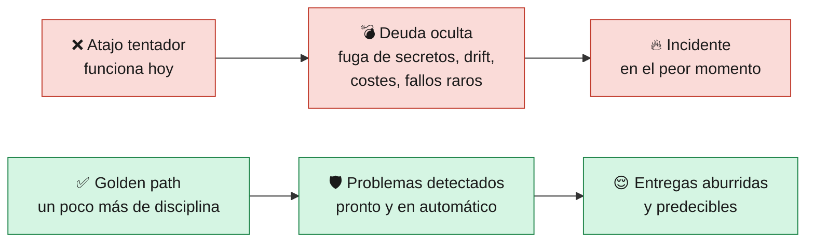
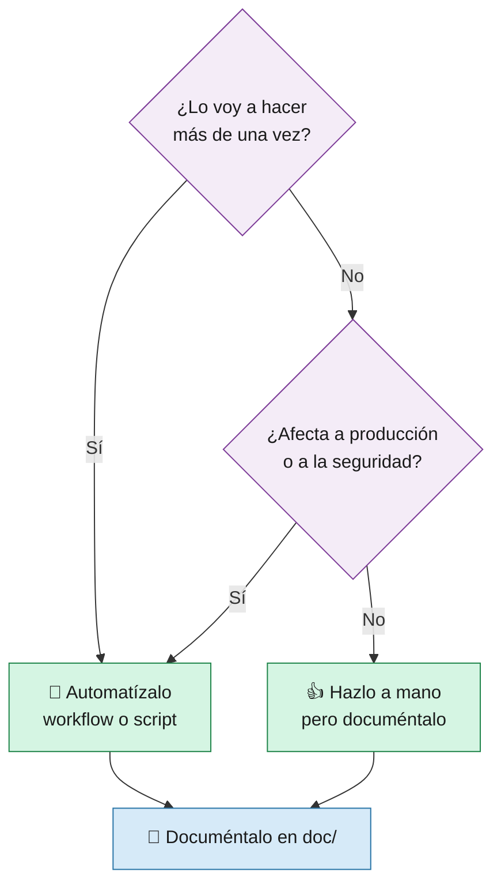

# 13 · ⛔ Qué NO hacer

> 🎯 **Objetivo:** reconocer los errores más comunes (antipatrones) al construir y usar una plataforma, y en concreto en este proyecto, junto con la alternativa correcta.

Aprender qué **no** hacer ahorra más tiempo que aprender un comando nuevo. Cada fila tiene: ❌ lo que no hay que hacer, ✅ qué hacer en su lugar y 🧠 por qué.

---

## 🏛️ Antipatrones de Ingeniería de Plataforma

| ❌ No hagas | ✅ Haz en su lugar | 🧠 Por qué |
|-------------|-------------------|------------|
| Construir la plataforma **sin preguntar** a los desarrolladores ("constrúyelo y vendrán") | Entrevistar a los equipos, empezar por su mayor dolor | Una plataforma que nadie usa es solo coste |
| Renombrar al equipo de operaciones como "equipo de plataforma" y seguir igual | Cambiar el modelo: producto, autoservicio, roadmap y feedback | El nombre no cambia nada; el modelo sí |
| **Ticket-ops**: que todo se pida por ticket y lo haga una persona | Autoservicio: un botón, un workflow, una plantilla | Los tickets crean colas y esperas |
| Construir un **portal gigante** antes de tener nada que ofrecer | **Thinnest Viable Platform**: lo mínimo útil y crecer | El portal sin golden paths detrás es una fachada vacía |
| **Obligar** a usar la plataforma sin que aporte valor | Que el golden path sea **el camino más cómodo** | Si hay que obligar, la plataforma no está resolviendo el problema |
| No dejar **ninguna salida** (escape hatch) para casos especiales | Golden path por defecto y forma documentada de salirse | Los casos especiales existen; si no hay salida, se hacen a escondidas |
| **Abstraerlo todo** hasta que nadie entiende qué pasa debajo | Ocultar lo innecesario pero **dejar ver** los detalles (logs, comandos) | Cuando algo falla, hay que poder entenderlo |
| Plataforma **sin documentación** | Docs como código, con ejemplos y laboratorio | Sin docs, el autoservicio es imposible |
| No **medir** nada | DORA + adopción + tiempo hasta el primer despliegue | Sin métricas no sabes si la plataforma mejora algo |
| Dar soporte a **todas** las tecnologías desde el día 1 | Pocas opciones bien soportadas | Cada opción extra multiplica el mantenimiento |

---

## 🔐 Seguridad

| ❌ No hagas | ✅ Haz en su lugar | 🧠 Por qué |
|-------------|-------------------|------------|
| Poner contraseñas o claves **en el código** (como `API_KEY` en `main.go`) | GitHub Secrets, Key Vault, Secrets Manager | El código se copia, se publica y queda en el historial de git **para siempre** |
| Guardar contraseñas en **variables** de GitHub | Usar **secrets** | Las variables se ven en claro en los logs |
| Hacer `echo` de un secret o de una contraseña obtenida en el pipeline | `::add-mask::` (como en `deploy-containerapp.sh`) o no imprimirla | Los logs los puede leer mucha gente |
| Subir `.env` o `local.settings.json` al repositorio | Añadirlos a `.gitignore` | Suelen contener secretos reales |
| Dar **Owner/Contributor de toda la suscripción** o `AdministratorAccess` en AWS a la identidad del pipeline | Mínimo privilegio: Contributor **solo** en el Resource Group, IAM con acciones concretas | Si se filtra la credencial, el daño queda acotado |
| Usar **claves de larga duración** en producción | **OIDC** (federated credentials): GitHub obtiene tokens temporales sin guardar claves | En este curso usamos claves fijas **para simplificar**; en una empresa real, OIDC |
| **Desactivar** escáneres o tests para que el pipeline "salga en verde" | Arreglar el hallazgo o documentar la excepción | Un pipeline verde que no comprueba nada es peor que uno rojo |
| Dejar `fail-build: false` y `warn-only: true` en producción | Bloquear en HIGH/CRITICAL | En el curso están así **solo para poder ver los hallazgos** |
| Copiar los endpoints `/search` y `/exec` | Consultas parametrizadas y sin `sh -c` (ver [10 · Seguridad](10-Seguridad.md)) | Son vulnerabilidades **de ejemplo** |
| Dejar la infra del curso **encendida** con esos endpoints públicos | `infra-multicloud.yml` → `destroy` al terminar | `/exec` permite ejecutar comandos en la nube |

---

## 🚀 Despliegues y pipelines

| ❌ No hagas | ✅ Haz en su lugar | 🧠 Por qué |
|-------------|-------------------|------------|
| Desplegar a producción **desde tu portátil** | Siempre por el pipeline | El pipeline es reproducible, auditado y pasa por los controles de seguridad |
| Hacer push **directo a `main`** | Rama + Pull Request + revisión | El SCA (`dependency-review`) **solo se ejecuta en PRs** |
| Usar el tag **`latest`** en imágenes | Tag inmutable por commit (`<sha_corto>`) o digest | Con `latest` no sabes qué versión corre ni puedes volver atrás |
| Construir **una imagen distinta para cada nube** | Construir una vez y promover por digest (`cd-go-multicloud.yml`) | Si son distintas, un fallo puede aparecer solo en una nube |
| Construir imágenes para Lambda sin `--platform linux/amd64 --provenance=false --sbom=false` | Usar siempre esas opciones | Lambda rechaza índices multi-arquitectura o con attestations |
| Quitar el **smoke test** porque "a veces tarda" | Mantenerlo con reintentos (el cold start es normal) | Es lo único que confirma que la app responde de verdad |
| Cambiar el mensaje `Hola ED Team` sin actualizar tests y smoke test | Cambiar los tres a la vez | Fallarán `main_test.go` y `smoke-test.sh` (¡y está bien que fallen!) |
| **Copiar y pegar** lógica de despliegue en cada workflow | Scripts reutilizables (`scripts/`) o workflows reutilizables | Arreglas un bug una vez, no N veces |
| Usar actions por **tag** (`@v4`) o actions **archivadas** | Fijarlas por **SHA** con `# vX.Y.Z` y dejar que Dependabot las actualice | Un tag se puede mover; una action archivada no recibe parches (ver [14 · Buenas prácticas](14-Buenas-Practicas-GitHub.md)) |
| Dar permisos amplios a nivel de workflow | `permissions: {}` arriba y permisos mínimos **por job** | Si un job se compromete, solo puede hacer lo que su permiso permite |
| **Hardcodear** nombres (`ACR_NAME="acredteamdevsecops"`) | Variables de GitHub (`vars.REGISTRY_NAME`) | Otra persona o entorno no puede reutilizar el pipeline |
| Relanzar un job fallido **sin leer el error** | Leer el log y el [árbol de diagnóstico](09-Operacion-y-Troubleshooting.md) | Los reintentos a ciegas esconden problemas reales |
| Aprobar un deploy a `production` **sin mirar** qué se despliega | Revisar el commit, la release y el resultado del CI | La aprobación es un control, no un trámite |

---

## ☁️ Infraestructura y nube

| ❌ No hagas | ✅ Haz en su lugar | 🧠 Por qué |
|-------------|-------------------|------------|
| Crear o cambiar recursos **a mano en el portal** (*ClickOps*) | Cambiar el workflow o script y ejecutarlo | Lo manual no queda registrado, no se repite igual y causa *drift* |
| Cambiar a mano una Lambda o Container App creada por el pipeline | Cambiar `scripts/deploy-*.sh` | El siguiente despliegue puede sobrescribir o chocar con tu cambio |
| Dejar recursos encendidos "por si acaso" | `destroy` al terminar; etiquetas y presupuestos | Lo que no se usa también cuesta |
| Poner `--min-replicas 1` en todo "para evitar el cold start" | Aceptar el cold start salvo que el caso lo exija | Una réplica mínima **cobra 24/7** y anula la ventaja serverless |
| Borrar el **Resource Group** completo para limpiar | Usar `destroy` (conserva el RG) | El RG puede tener otras cosas y permisos asignados |
| Usar nombres genéricos (`func-app`, `storage1`) | Nombres únicos con prefijo/iniciales | ACR, Function App y Storage son **únicos en todo Azure** |
| Dar a la Lambda más permisos "por si los necesita" | Solo `AWSLambdaBasicExecutionRole` y añadir lo justo | Mínimo privilegio |

---

## 📖 Documentación

| ❌ No hagas | ✅ Haz en su lugar | 🧠 Por qué |
|-------------|-------------------|------------|
| Editar la **Wiki directamente** en GitHub | Editar `doc/` y hacer push | `wiki.yml` sobrescribe la wiki en cada publicación |
| Crear una página y **no enlazarla** | Añadirla a `_Sidebar.md` y a la tabla de `Home.md` | Lo que no se encuentra no existe |
| Documentar "para luego" | Documentar en el mismo PR que el cambio | Luego nunca llega y la doc queda desfasada |
| Usar tildes o espacios en nombres de archivo de `doc/` | `08-Laboratorio-Paso-a-Paso.md` | El nombre es la URL de la página |

---

## 💻 En tu máquina

| ❌ No hagas | ✅ Haz en su lugar | 🧠 Por qué |
|-------------|-------------------|------------|
| Instalar dependencias de Python en el **Python global** | Un entorno por proyecto (`uv`, `venv`) | Evita conflictos de versiones entre proyectos |
| Subir carpetas generadas (`build/`, `.venv/`, `__pycache__/`) | `.gitignore` | Ensucian el repo y causan conflictos |
| Probar solo en la nube | Probar antes en local: `go test`, `docker run`, `smoke-test.sh` | El ciclo local es de segundos; el de la nube, de minutos |

---

## 🧭 Regla de oro

➡️ Siguiente: [14 · Buenas prácticas de GitHub](14-Buenas-Practicas-GitHub.md) · ⬅️ Volver al [Inicio](Home.md) · Repasa [0 · ¿Qué es Ingeniería de Plataforma?](00-Ingenieria-de-Plataforma.md)
