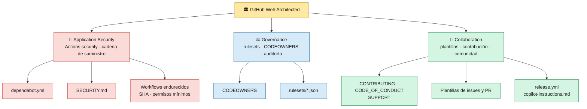
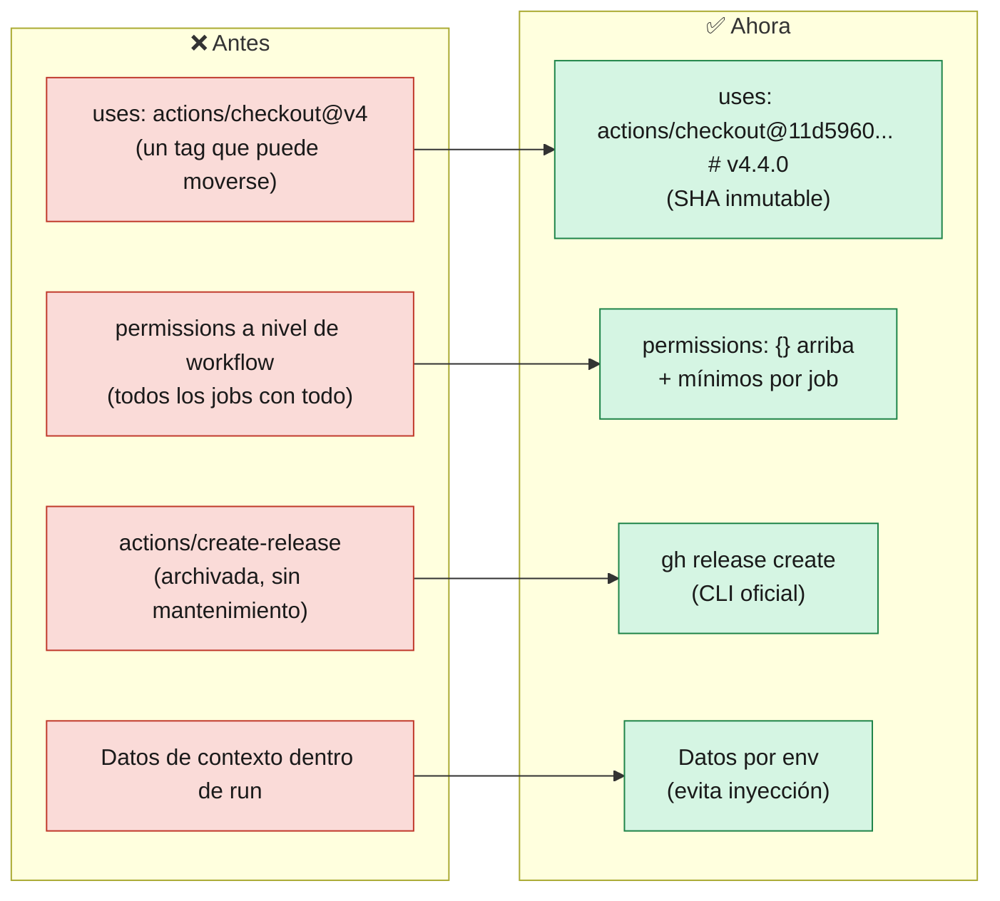
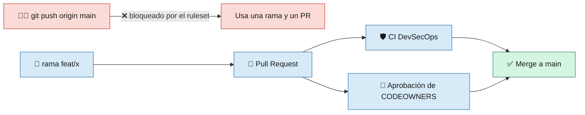

# 14 · Buenas prácticas de GitHub (Well-Architected)

> 🎯 **Objetivo:** conocer los archivos de `.github/` que convierten un repositorio en un repositorio **bien gobernado, seguro y fácil de colaborar**, y los ajustes que hay que activar en GitHub.

El [GitHub Well-Architected Framework](https://wellarchitected.github.com/) organiza las buenas prácticas en **pilares**. En este repo aplicamos sobre todo tres:

---

## 📁 Los archivos de `.github/`

| Archivo | Pilar | Para qué sirve |
|---------|-------|----------------|
| [`CODEOWNERS`](../.github/CODEOWNERS) | Governance | Define **quién debe aprobar** los cambios de cada carpeta. Protege especialmente `.github/` y `scripts/` |
| [`dependabot.yml`](../.github/dependabot.yml) | Security | Abre PRs semanales para actualizar Actions, módulos Go, paquetes Python e imágenes Docker. Espera 7 días (`cooldown`) antes de proponer versiones recién publicadas |
| [`SECURITY.md`](../.github/SECURITY.md) | Security | Cómo reportar vulnerabilidades **en privado** y qué vulnerabilidades son intencionales |
| [`CONTRIBUTING.md`](../.github/CONTRIBUTING.md) | Collaboration | Flujo de ramas y PRs, formato de commits, qué comprobar antes de abrir un PR |
| [`CODE_OF_CONDUCT.md`](../.github/CODE_OF_CONDUCT.md) | Collaboration | Normas de convivencia (adaptado de Contributor Covenant 2.1) |
| [`SUPPORT.md`](../.github/SUPPORT.md) | Collaboration | Dónde pedir ayuda y qué incluir en una pregunta |
| [`pull_request_template.md`](../.github/pull_request_template.md) | Collaboration | Checklist que aparece al abrir un PR |
| [`ISSUE_TEMPLATE/`](../.github/ISSUE_TEMPLATE) | Collaboration | Formularios para bug, mejora, pregunta del curso y documentación. Desactiva los issues en blanco |
| [`release.yml`](../.github/release.yml) | Collaboration | Agrupa por etiquetas las notas de release que generan los CD (`--generate-notes`) |
| [`copilot-instructions.md`](../.github/copilot-instructions.md) | Productivity | Reglas del repo para GitHub Copilot. Como se inyecta en los prompts, **revísalo en cada PR** igual que el código |
| [`rulesets/`](../.github/rulesets) | Governance | Reglas de protección de rama y de tags, listas para **importar** |
| [`workflows/`](../.github/workflows) | Security | Pipelines endurecidos (ver abajo) |

> 💡 `SECURITY.md`, `CONTRIBUTING.md`, `CODE_OF_CONDUCT.md` y `SUPPORT.md` son **archivos de salud de la comunidad**: GitHub los reconoce en `.github/`, en la raíz o en `docs/`, y los muestra en la pestaña *Community Standards* (*Insights → Community Standards*).

---

## 🔐 Workflows endurecidos (Actions security)

| Práctica | Por qué |
|----------|---------|
| **Actions fijadas por SHA** con comentario `# vX.Y.Z` | Un tag (`@v4`) lo puede mover quien controle la action; un SHA no. Dependabot actualiza el SHA y el comentario |
| **`permissions: {}`** a nivel de workflow y permisos **por job** | Cada job recibe solo lo que necesita: el que publica la release puede escribir; el que compila, solo leer |
| **Nada de actions archivadas** | Una action sin mantenimiento no recibe parches de seguridad |
| **Datos de contexto por `env`** | Escribir `${{ ... }}` dentro de `run` permite inyectar comandos si el valor viene de un usuario |
| **Sin `pull_request_target`** | Ejecuta código de forks con permisos elevados |

Permisos por job en este repo:

| Job | Permisos |
|-----|----------|
| Build, deploy, test, validate | `contents: read` |
| Release (crea el tag y la release) | `contents: write` |
| CodeQL y Container scan | `contents: read`, `security-events: write`, `actions: read` |
| Dependency review (comenta en el PR) | `contents: read`, `pull-requests: write` |
| Build de Go en `cd-go.yml` y `build_once` del multi-cloud (suben la imagen a GHCR) | `contents: read`, `packages: write` |
| Publicar la wiki | `contents: write` |
| Infraestructura | ninguno |

> 🧭 **Pendiente recomendado por el framework:** usar **OIDC** en vez de las claves fijas `AZURE_CREDENTIALS` / `AWS_ACCESS_KEY_ID`. En el curso se usan claves por simplicidad (ver [13 · Qué NO hacer](13-Que-NO-hacer.md)).

---

## ⚖️ Rulesets: proteger `main` y los tags

Los rulesets no se activan solo por estar en el repo: hay que **importarlos**.

**Settings → Rules → Rulesets → New ruleset → Import a ruleset** y elegir cada JSON de [`.github/rulesets/`](../.github/rulesets):

| Ruleset | Reglas |
|---------|--------|
| `proteccion-main.json` | No borrar `main` · no force push · cambios solo por **PR** con 1 aprobación, revisión de **CODEOWNERS**, conversaciones resueltas y aprobaciones anuladas si hay commits nuevos. El rol **Admin** puede saltárselo solo vía PR (para quien mantiene el repo en solitario) |
| `proteccion-tags-release.json` | Los tags `v*`, `go-v*`, `go-mc-v*` no se pueden borrar ni mover: cada release queda trazable |

### ¿Por qué no se exigen los checks de CI en el ruleset?

Los workflows de CI tienen **filtros de rutas** (`src/**`, `src-go/**`). El Well-Architected advierte que un workflow filtrado configurado como *required status check* se queda **pendiente para siempre** cuando el PR no toca esas rutas, y bloquea el merge. Si quieres exigirlos, primero quita los filtros de `paths` o crea un workflow que siempre se ejecute.

### ¿Y los commits firmados?

El framework recomienda exigirlos (regla `required_signatures`) **cuando la mayoría del equipo ya firma**. En un curso con estudiantes empezando bloquearía a casi todos, por eso queda como recomendación en [`CONTRIBUTING.md`](../.github/CONTRIBUTING.md).

---

## ☑️ Ajustes que hay que activar a mano

Estos controles **no se pueden configurar con archivos**; se activan en *Settings*:

| Ajuste | Dónde | Pilar |
|--------|-------|-------|
| **Dependabot alerts** y **security updates** | *Settings → Advanced Security* | Security |
| **Secret scanning** y **push protection** (bloquea pushes con secretos) | *Settings → Advanced Security* | Security |
| **Private vulnerability reporting** (lo usa `SECURITY.md`) | *Settings → Advanced Security* | Security |
| **CodeQL** (ya lo ejecutan `ci.yml` y `ci-go.yml`) | *Security → Code scanning* | Security |
| `GITHUB_TOKEN` en **solo lectura** por defecto | *Settings → Actions → General → Workflow permissions* | Security |
| Permitir solo actions **fijadas por SHA** / de autores verificados | *Settings → Actions → General → Actions permissions* | Security |
| Importar los **rulesets** | *Settings → Rules → Rulesets* | Governance |
| Environment `production` con revisores | *Settings → Environments* | Governance |
| Activar **Wiki** (y crear la primera página) | *Settings → General → Features* | Collaboration |
| Etiquetas `security` e `ignore-for-release` (las usa `release.yml`) | *Issues → Labels* | Collaboration |

> ⚠️ En repositorios **privados**, secret scanning, push protection y code scanning requieren **GitHub Advanced Security** (*Secret Protection* / *Code Security*), y la Wiki requiere un plan de pago. En repositorios **públicos** son gratuitos.

---

## ✅ Checklist

- [ ] `CODEOWNERS` con usuarios o equipos que **existen** (si no, GitHub lo ignora)
- [ ] Rulesets importados y en estado **Active**
- [ ] Dependabot alerts + security updates activados
- [ ] Secret scanning + push protection activados
- [ ] Private vulnerability reporting activado
- [ ] `GITHUB_TOKEN` en solo lectura por defecto
- [ ] *Insights → Community Standards* todo en verde

⬅️ Volver al [Inicio](Home.md)
