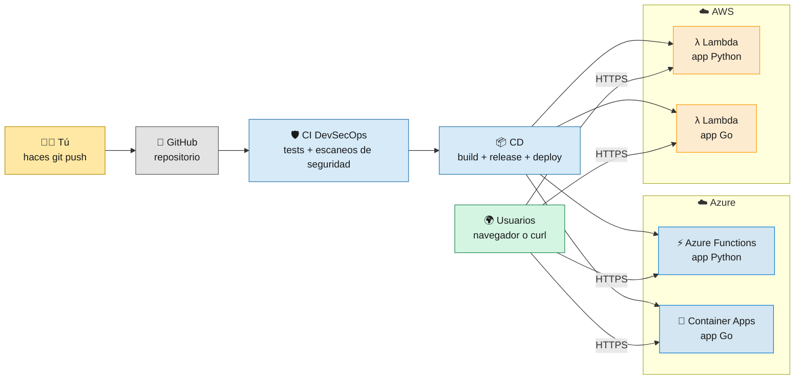

# 🚀 Reto Platform Engineering — ED Team

Bienvenido/a a la wiki del curso. En este proyecto vas a ver **cómo una aplicación pasa del código a internet de forma automática y segura**, desplegándose en servicios **serverless** de **Azure** y **AWS** con **GitHub Actions**.

> 🛠️ **¿Qué es esto de Ingeniería de Plataforma?** Construir un **camino fácil, seguro y de autoservicio** para que cualquier equipo lleve su app a producción sin tener que ser experto en todo. Este proyecto es el **punto de partida**: el golden path de **un solo equipo**. Funciona, pero cada equipo nuevo tendría que copiarlo y configurarlo a mano; convertirlo en una plataforma para muchos es lo que se construye en el curso. Empieza por [0 · ¿Qué es Ingeniería de Plataforma?](00-Ingenieria-de-Plataforma.md).
>
> ⛔ Y tan importante como saber hacer es saber **qué no hacer**: [13 · Qué NO hacer](13-Que-NO-hacer.md).

> 💡 **Serverless** no significa "sin servidores": significa que **tú no los administras**. Subes tu código o tu contenedor y la nube se encarga de arrancarlo, escalarlo y apagarlo cuando nadie lo usa.

---

## 🗺️ El proyecto en un vistazo

Dos APIs muy sencillas (una en **Python**, otra en **Go**) responden lo mismo:

| Endpoint | Respuesta |
|----------|-----------|
| `GET /` | `{"message": "Hola ED Team"}` |
| `GET /health` | `{"status": "healthy"}` |

La app es simple **a propósito**: lo importante del curso es todo lo que pasa alrededor (seguridad, automatización, infraestructura y despliegue).

---

## 📚 Ruta de aprendizaje

Sigue las páginas en orden la primera vez:

| # | Página | Qué aprendes |
|---|--------|--------------|
| 0 | [¿Qué es Ingeniería de Plataforma?](00-Ingenieria-de-Plataforma.md) | Qué problema resuelve, golden paths, autoservicio, DevOps vs SRE vs Plataforma, métricas DORA y dónde encaja este repo |
| 1 | [Introducción a Serverless](01-Introduccion-Serverless.md) | Qué es serverless, cold start, escalar a cero, comparación con Kubernetes |
| 2 | [Arquitectura](02-Arquitectura.md) | Cómo encajan todas las piezas |
| 3 | [Aplicaciones](03-Aplicaciones.md) | El código, los Dockerfiles, los paquetes zip y el truco del Lambda Web Adapter |
| 4 | [Pipeline CI DevSecOps](04-Pipeline-CI-DevSecOps.md) | SAST, SCA y escaneo de contenedores |
| 5 | [Pipeline CD Despliegue](05-Pipeline-CD-Despliegue.md) | Cómo llega el código a Azure y AWS |
| 6 | [Infraestructura](06-Infraestructura.md) | Qué recursos se crean y cómo se destruyen |
| 7 | [Configuración de GitHub](07-Configuracion-GitHub.md) | Secrets, variables, permisos y environments |
| 8 | [Laboratorio paso a paso](08-Laboratorio-Paso-a-Paso.md) | 🧪 Práctica guiada: de cero a desplegado |
| 9 | [Operación y Troubleshooting](09-Operacion-y-Troubleshooting.md) | Comandos útiles y errores típicos |
| 10 | [Seguridad](10-Seguridad.md) | Controles DevSecOps y vulnerabilidades de ejemplo |
| 11 | [Publicar la Wiki](11-Publicar-la-Wiki.md) | Cómo esta documentación se publica sola |
| 12 | [Glosario](12-Glosario.md) | Todos los términos en un solo sitio |
| 13 | [⛔ Qué NO hacer](13-Que-NO-hacer.md) | Antipatrones de plataforma y errores típicos en seguridad, pipelines, nube y docs |
| 14 | [Buenas prácticas de GitHub](14-Buenas-Practicas-GitHub.md) | Well-Architected: CODEOWNERS, Dependabot, rulesets, plantillas y workflows endurecidos |

---

## ⚡ Atajo: ¿qué app va a qué servicio?

| App | Azure | AWS |
|-----|-------|-----|
| 🐍 Python (Flask) | ⚡ **Azure Functions** (plan Flex Consumption) | λ **AWS Lambda** (zip) + Function URL |
| 🐹 Go (net/http) | 🐳 **Azure Container Apps** (imagen en GHCR) | λ **AWS Lambda** (zip) + Function URL |

Así en un solo proyecto practicas **tres servicios serverless distintos**: funciones con código (Azure Functions), contenedores serverless (Container Apps) y una app web normal dentro de funciones gracias al Lambda Web Adapter (Lambda). Y sin ningún registry de contenedores en la nube: la única imagen vive en GitHub Container Registry.

---

## 📁 Dónde está cada cosa en el repositorio

| Carpeta / archivo | Contenido |
|-------------------|-----------|
| [`src/`](../src) | App Python (Flask) + entrada de Azure Functions |
| [`src-go/`](../src-go) | App Go + tests |
| [`scripts/`](../scripts) | Scripts de despliegue reutilizables |
| [`.github/workflows/`](../.github/workflows) | Todos los pipelines |
| [`doc/`](.) | Esta wiki (se publica automáticamente) |
